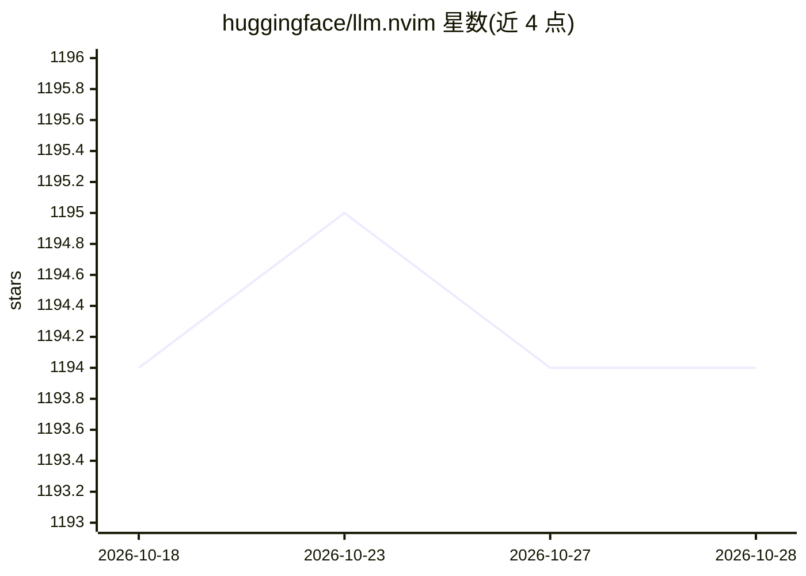

# huggingface/llm.nvim

⭐ 1,194 · Lua · Apache-2.0 · 推送 2026-09-23 · [GitHub](https://github.com/huggingface/llm.nvim) · 组织维护

**Neovim 的 LLM 代码补全插件，支持多种推理后端**

面向 Neovim 用户的 LLM 插件，通过 llm-ls 后端提供 Copilot 式 ghost-text 代码补全。可对接多种后端：Hugging Face Inference API、Ollama、OpenAI 兼容接口和 TGI，也支持自定义 HTTP 端点。使用 tokenizers 计算并裁剪 prompt 使其始终适配上下文窗口。llm-ls 二进制在插件首次加载时自动下载，也可经 Mason 安装；通过 packer/lazy.nvim/vim-plug 安装。

## 筛选速览

| 维度 | 判定 | 备注 |
|---|---|---|
| AI 角色 | `ai-ecosystem` | LLM/agent 周边工具 |
| 许可风险 | `permissive` | Apache-2.0 |
| 部署形态 | `desktop` | 安装包/桌面程序 |
| 模型依赖 | local-ok | 支持本地模型 |
| 硬件要求 | — | 无带数字的原话,不猜 |
| 安装摩擦 | `low` | 无编译、无系统依赖或容器化 |
| 成熟度 | — | 结构信号不足 |

## 能力要点

- ghost-text 式代码补全（类 Copilot 体验）
- 支持 Hugging Face Inference API、Ollama、OpenAI 兼容接口、TGI 等多种后端
- 基于 tokenizers 自动裁剪 prompt 以适配上下文窗口
- llm-ls 二进制首次加载时自动下载，亦可 Mason 安装

## 适用场景

- 在 Neovim 中边写代码边获得 LLM 补全建议
- 接入本地 Ollama 或自建 TGI/OpenAI 兼容端点做补全
- 仅对指定项目或指定文件类型启用自动建议

## 场景标签

`代码生成` · 领域:编码与开发

## 证据(README 行号)

> L3: **llm.nvim** is a plugin for all things LLM. It uses **llm-ls** as a backend.
> L36: **llm.nvim** can interface with multiple backends hosting models.
> L66: ##### **backend = "ollama"**

## 星数曲线

2026-10-18 1,194 → 2026-10-28 1,194（+0）

---
*卡片 v1 · prompt 1.4 · 生成 2026-10-21 · 置信度 high · 依据 README sha `be003a5cbf1d` · [字段定义](../../DATASET.md)*
