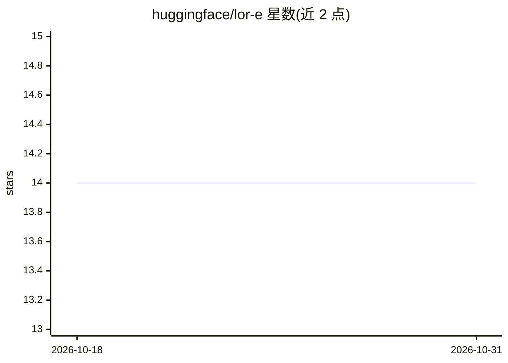

# huggingface/lor-e

⭐ 14 · Rust · 推送 2026-09-29 · [GitHub](https://github.com/huggingface/lor-e) · 组织维护

**帮助 transformers 贡献者查找相关 issue 的机器人**

huggingface 维护的 issue 机器人：当贡献者提交问题时，机器人查找仓库中可能相关的既有 issue，提示答案可能已存在但难以检索到。面向 transformers 仓库的贡献者与维护者。README 仅三行，未说明所用检索机制、部署方式或配置方法，具体实现需查阅代码。

## 筛选速览

| 维度 | 判定 | 备注 |
|---|---|---|
| AI 角色 | `ai-ecosystem` | LLM/agent 周边工具 |
| 许可风险 | `none` | — |
| 部署形态 | `None` |  |
| 模型依赖 | — | README 未给出锁定关系 |
| 硬件要求 | — | 无带数字的原话,不猜 |
| 安装摩擦 | `low` | 无编译、无系统依赖或容器化 |
| 成熟度 | — | 结构信号不足 |

## 能力要点

- 自动查找与新 issue 相关的已有 issue

## 适用场景

- 提交 issue 前发现已有相似问题与答案
- 减少仓库中重复 issue 的产生

## 场景标签

`语义搜索` · 领域:知识与检索

## 证据(README 行号)

> L3: LOR-E is a bot that will help contributors find related issues to their problem, in the hope that an answer already 

## 星数曲线

2026-10-18 14 → 2026-10-31 14（+0）

---
*卡片 v1 · prompt 1.4 · 生成 2026-10-31 · 置信度 low · 依据 README sha `ceedc7585b80` · [字段定义](../../DATASET.md)*
