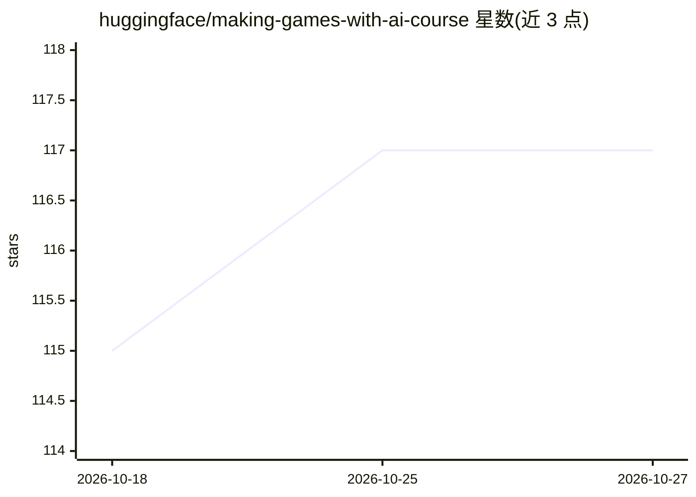

# huggingface/making-games-with-ai-course

⭐ 117 · MDX · 推送 2026-10-14 · [GitHub](https://github.com/huggingface/making-games-with-ai-course) · 组织维护

**Hugging Face 的机器学习游戏课程内容仓库（mdx 与 notebooks）**

存放 Machine Learning for Games 课程的 mdx 文件与 notebooks，课程网站托管于 huggingface.co/learn，含教学大纲与课程正文链接，可免费注册。仓库由 Thomas Simonini 编写，并提供 BibTeX 引用格式供出版物引用。仓库本身不含安装运行的产品代码，仅为课程内容载体。

## 筛选速览

| 维度 | 判定 | 备注 |
|---|---|---|
| AI 角色 | `ai-knowledge` | 知识聚合/清单类 |
| 许可风险 | `none` | — |
| 部署形态 | `None` |  |
| 模型依赖 | — | README 未给出锁定关系 |
| 硬件要求 | — | 无带数字的原话,不猜 |
| 安装摩擦 | `low` | 无编译、无系统依赖或容器化 |
| 成熟度 | — | 结构信号不足 |

## 能力要点

- 包含课程 mdx 文件与 notebooks
- 课程网站含教学大纲与正文（huggingface.co/learn）
- 提供 BibTeX 引用格式

## 适用场景

- 学习机器学习在游戏中的应用
- 引用该课程于出版物

## 场景标签

`教程课程` · 领域:学习与行业

## 证据(README 行号)

> L7: This repository contains the Machine Learning for Games Course mdx files and notebooks. **The website is here** 👉 ht
> L9: - The syllabus 📚: https://huggingface.co/learn/ml-games-course/unit0/syllabus

## 星数曲线

2026-10-18 115 → 2026-10-27 117（+2）

---
*卡片 v1 · prompt 1.4 · 生成 2026-10-23 · 置信度 high · 依据 README sha `51b3162ca99a` · [字段定义](../../DATASET.md)*
