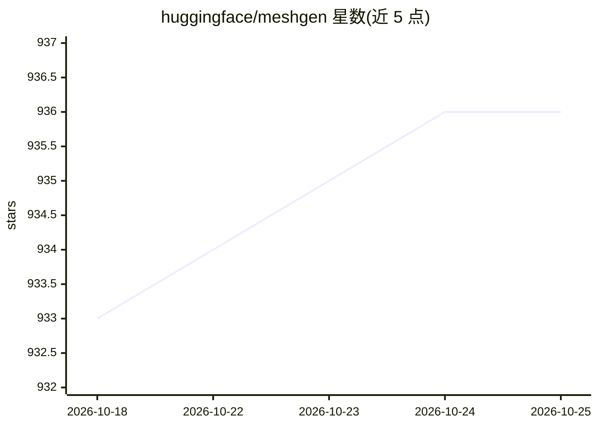

# huggingface/meshgen

⭐ 936 · Python · MIT · 推送 2026-10-22 · [GitHub](https://github.com/huggingface/meshgen) · 组织维护

**Blender 插件：用自然语言让 AI Agent 操作 Blender 建模**

以 Blender 附加组件形式提供的 AI Agent 工具：在侧边栏输入提示词（如“创建一个雪人”），Agent 控制 Blender 执行操作。后端可选本地推理（Blender 内直接运行 GGUF 模型，需 8GB 以上显存的 NVIDIA GPU 与 CUDA 版插件，或连接本地 Ollama / llama.cpp），也可通过 Hugging Face / Anthropic / OpenAI API 远程推理。另含 LLaMA-Mesh 本地网格理解生成与 Hyper3D 高保真网格生成两个可选集成。安装方式为下载各平台 ZIP 并在 Blender 中安装。

## 筛选速览

| 维度 | 判定 | 备注 |
|---|---|---|
| AI 角色 | `ai-native` | 本体是模型或模型工具 |
| 许可风险 | `permissive` | MIT |
| 部署形态 | `desktop` | 安装包/桌面程序 |
| 模型依赖 | local-ok | 支持本地模型 |
| 硬件要求 | — | 无带数字的原话,不猜 |
| 安装摩擦 | `medium` | 含编译或系统依赖之一 |
| 成熟度 | — | 结构信号不足 |

## 能力要点

- 自然语言驱动 Agent 控制 Blender
- 本地后端（Blender 内 GGUF 推理 / Ollama / llama.cpp）与远程 API 后端（Hugging Face / Anthropic / OpenAI）可选
- 可选 LLaMA-Mesh 本地网格理解生成（需 8GB+ 显存 NVIDIA GPU 与 CUDA 版）
- 可选 Hyper3D 高保真 3D 网格生成（提供免费 API key）

## 适用场景

- 在 Blender 里用一句话生成或修改 3D 模型
- 不想付费 API 时用本地模型或 Ollama 免费运行
- 结合 Hyper3D 生成高保真网格

## 场景标签

`GUI 自动化` · 领域:效率与自动化

## 证据(README 行号)

> L3: Use AI Agents to control Blender with natural language.
> L128: - Press `N` -> `MeshGen` (or `View` -> `Sidebar` -> Select the `MeshGen` tab)
> L129: - Enter a prompt, for example: `Create a snowman`

## 星数曲线

2026-10-18 933 → 2026-10-25 936（+3）

---
*卡片 v1 · prompt 1.4 · 生成 2026-10-21 · 置信度 high · 依据 README sha `e0f8c0dd8d9d` · [字段定义](../../DATASET.md)*
