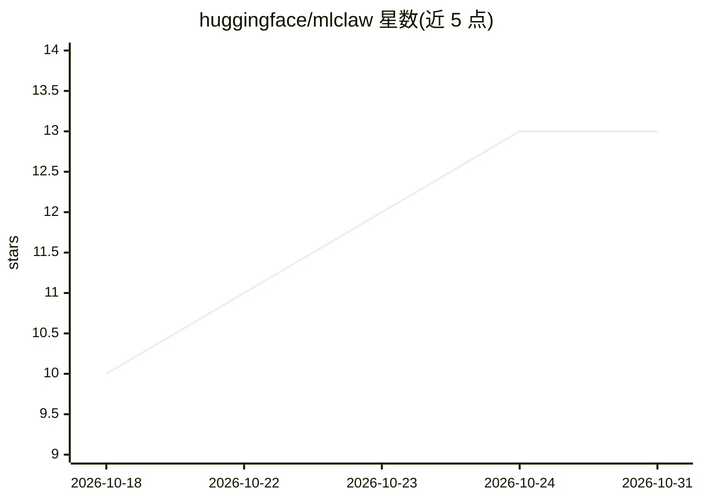

# huggingface/mlclaw

⭐ 13 · TypeScript · MIT · 推送 2026-10-14 · [GitHub](https://github.com/huggingface/mlclaw) · [官网](http://mlclaw.dev/) · 组织维护

**将 OpenClaw agent 部署到 Hugging Face Space 的部署工具**

Hugging Face 官方仓库，把 OpenClaw agent 以受保护的 Docker Space 形式部署，状态持久化到私有 Storage Bucket。核心机制是凭证分层：浏览器不接收 OpenClaw gateway token，由 ML Claw 认证 HF OAuth 用户后经 loopback 代理流量；HF Broker 持有细粒度凭证，OpenClaw 进程只获得受限 agent 凭证。支持通过 --model 选择 Hugging Face Router 模型（GLM、Qwen、DeepSeek、Kimi、GPT-OSS 等），可选 Telegram 通道与本地网关模式（Docker/Podman，Tailscale 访问）。给需要在 Hugging Face 或本地运行 OpenClaw agent 的开发者使用。限制：托管 Docker Space 需 PRO 账户，Telegram/Discord 连通需付费 Space 硬件。

## 筛选速览

| 维度 | 判定 | 备注 |
|---|---|---|
| AI 角色 | `ai-ecosystem` | LLM/agent 周边工具 |
| 许可风险 | `permissive` | MIT |
| 部署形态 | `self-host` | docker 或自建部署 |
| 模型依赖 | — | README 未给出锁定关系 |
| 硬件要求 | — | 无带数字的原话,不猜 |
| 安装摩擦 | `low` | 无编译、无系统依赖或容器化 |
| 成熟度 | — | 结构信号不足 |

## 能力要点

- 一键部署受保护 Docker Space 与私有 Storage Bucket 状态持久化
- OAuth 认证 + loopback 代理 + HF Broker 细粒度凭证隔离
- 支持 Hugging Face Router 多模型选择与 Telegram 双通道
- 本地网关模式支持 Docker/Podman 与 Space 间无状态丢失迁移

## 适用场景

- 把我的 OpenClaw agent 部署到 Hugging Face Space 上长期运行
- 在本地 Docker/Podman 中运行同一网关并在两处间迁移
- 给 agent 接入 Telegram 对话与审批按钮

## 场景标签

 · 领域:AI agent 部署/基础设施

## 证据(README 行号)

> L5: ML Claw deploys an OpenClaw agent on Hugging Face with durable state in a
> L14: The browser never receives an OpenClaw gateway token. ML Claw authenticates the
> L63: The broker owns the selected credential; OpenClaw receives only a separate

## 星数曲线

2026-10-18 10 → 2026-10-31 13（+3）

---
*卡片 v1 · prompt 1.4 · 生成 2026-10-31 · 置信度 mid · 依据 README sha `b32e99632c0f` · [字段定义](../../DATASET.md)*
