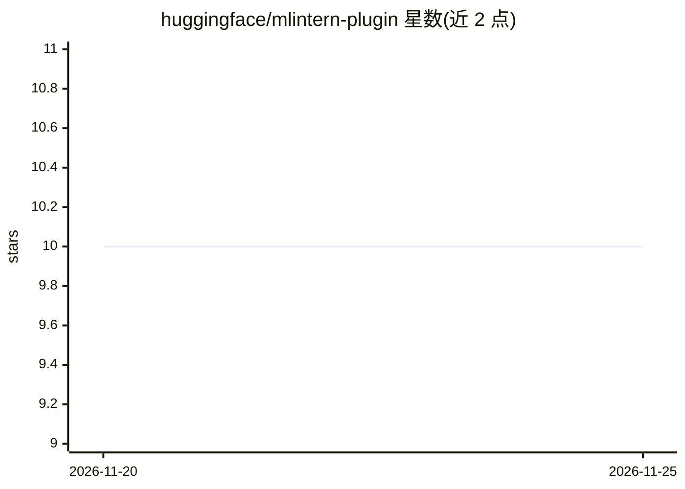

# huggingface/mlintern-plugin

⭐ 10 · JavaScript · 推送 2026-04-26 · [GitHub](https://github.com/huggingface/mlintern-plugin) · 组织维护

**在 Claude Code 中调用 HF ML Intern agent 的插件**

Hugging Face 的 Claude Code 插件，把开源 ML 工程师 agent「ML Intern」接入 Claude Code 会话：提供 /mlintern:setup 校验本地环境、run 命令运行微调/评测/发布模型等 ML 任务，支持后台运行、指定模型、查询任务状态、读取结果与取消任务。依赖 Node.js 18+ 与 ml-intern（需单独源码安装并配置 HF token 及模型商密钥）。README 标注为实验性，接口可能频繁变动。

## 筛选速览

| 维度 | 判定 | 备注 |
|---|---|---|
| AI 角色 | `ai-ecosystem` | LLM/agent 周边工具 |
| 许可风险 | `none` | — |
| 部署形态 | `None` |  |
| 模型依赖 | locked-api |  |
| 硬件要求 | — | 无带数字的原话,不猜 |
| 安装摩擦 | `low` | 无编译、无系统依赖或容器化 |
| 成熟度 | `idea` | |

## 能力要点

- 提供 setup/run/status/result/cancel 等 slash 命令管理 ML 任务
- 支持后台运行任务并可指定模型（Anthropic 或 Hugging Face 托管）
- 通过 /plugin marketplace add 命令安装到 Claude Code

## 适用场景

- 在 Claude Code 对话中发起模型微调与评测任务
- 后台提交 ML 任务并查询进度与结果
- 复用 HF 上的开源模型执行数据集调研等任务

## 场景标签

`编码 Agent` `微调` `模型评测` · 领域:编码与开发

## 证据(README 行号)

> L5: ML Intern is an open-source ML engineer agent from Hugging Face that can research, write, and run ML workflows such 
> L13: - `/mlintern:setup` to verify local setup
> L53: /plugin marketplace add huggingface/mlintern-plugin

## 星数曲线

2026-11-20 10 → 2026-11-25 10（+0）

---
*卡片 v1 · prompt 1.4 · 生成 2026-11-20 · 置信度 high · 依据 README sha `14f1de79e8d4` · [字段定义](../../DATASET.md)*
