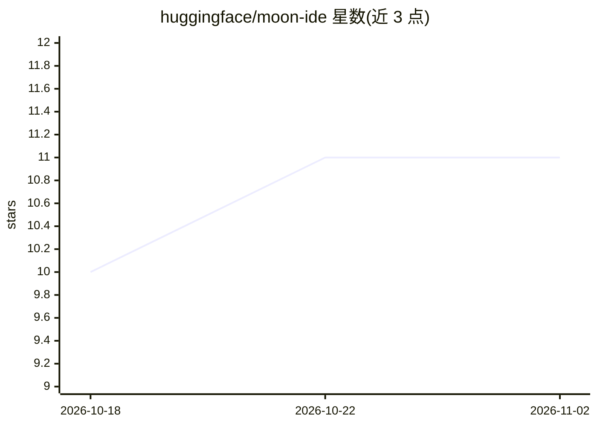

# huggingface/moon-ide

⭐ 11 · Rust · MIT · 推送 2026-11-01 · [GitHub](https://github.com/huggingface/moon-ide) · 组织维护

**面向团队的定制 IDE，Rust 核心内置编码 Agent 与容器化工作区**

Hugging Face moon 团队自研的桌面 IDE：Tauri 2（Rust 后端 + Web UI）+ Svelte 5 + CodeMirror 6 构建，核心是同一套 Rust core 可在宿主机或工作区容器内运行。内置进程内编码 Agent（coder），通过 OAuth 设备流接入 Hugging Face Inference Providers，支持容器感知工具与多仓库跨仓查询；提供 LSP、保存即格式化、手机伴侣 PWA（含中继与无头模式 moon-remote）、moon-base 工作区容器镜像。支持平台为 macOS Apple Silicon 与 Linux，不支持 Windows；需从源码构建运行。

## 筛选速览

| 维度 | 判定 | 备注 |
|---|---|---|
| AI 角色 | `ai-enhanced` | 去掉 AI 部分产品仍成立 |
| 许可风险 | `permissive` | MIT |
| 部署形态 | `self-host` | docker 或自建部署 |
| 模型依赖 | — | README 未给出锁定关系 |
| 硬件要求 | — | 无带数字的原话,不猜 |
| 安装摩擦 | `low` | 无编译、无系统依赖或容器化 |
| 成熟度 | `idea` | |

## 能力要点

- 内置编码 Agent：HF Inference Providers OAuth 登录、容器感知工具、多仓库跨仓查询
- 容器化 dev shell：终端/LSP/lint/format/build 运行在同一工作区容器内
- 手机伴侣 PWA 经 moon-bridge/relay 驱动 coder 会话，支持无头 moon-remote 服务模式
- 内建 TS/Rust/Go/Python/Svelte LSP 与保存即格式化的 formatter 链

## 适用场景

- 团队在容器化工作区内统一开发环境进行编码
- 通过 IDE 内 Agent 与手机端远程驱动代码会话与评审
- 多仓库工作区内做跨仓库的 Agent 查询

## 场景标签

`编码 Agent` · 领域:编码与开发

## 证据(README 行号)

> L10: - In-process coding agent ("coder"): Hugging Face Inference Providers via OAuth device-flow sign-in, container-awar
> L169:  - Let the editor be used without connecting to HF at all, as long as a model provider is supplied another way.

## 星数曲线

2026-10-18 10 → 2026-11-02 11（+1）

---
*卡片 v1 · prompt 1.4 · 生成 2026-11-02 · 置信度 mid · 依据 README sha `5204d5dbedae` · [字段定义](../../DATASET.md)*
