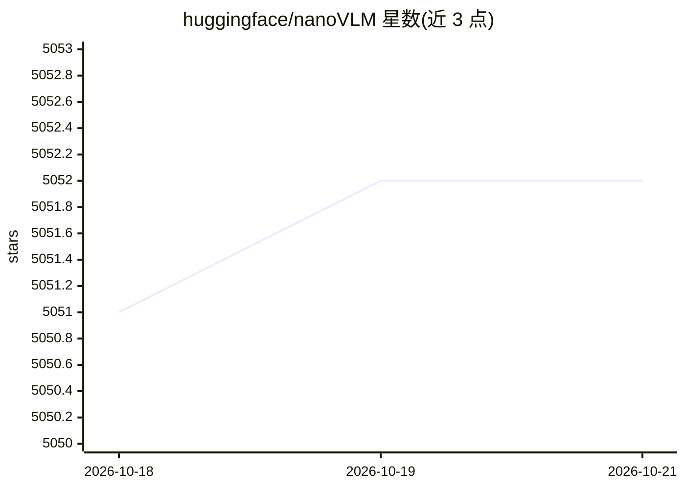

# huggingface/nanoVLM

⭐ 5,052 · Python · Apache-2.0 · 推送 2025-10-27 · [GitHub](https://github.com/huggingface/nanoVLM) · 组织维护

**面向学习的小型视觉语言模型训练/微调库**

用纯 PyTorch 实现的小型视觉语言模型训练与微调仓库：视觉主干 SigLIP、语言解码器 SmolLM2、模态投影与训练循环合计约 750 行。默认 222M 模型在单张 H100 上约 6 小时训练后 MMStar 准确率 35.3%。支持从 Hub 加载/上传权重、本地保存、lmms-eval 评测，并提供 VRAM 测量脚本（batch size 1 需约 4.5GB 显存）。2025 年 6 月与 9 月有破坏性变更，部分辅助脚本可能失效。

## 筛选速览

| 维度 | 判定 | 备注 |
|---|---|---|
| AI 角色 | `ai-native` | 本体是模型或模型工具 |
| 许可风险 | `permissive` | Apache-2.0 |
| 部署形态 | `library` | 以包/库形式分发 |
| 模型依赖 | — | README 未给出锁定关系 |
| 硬件要求 | — | 无带数字的原话,不猜 |
| 安装摩擦 | `medium` | 含编译或系统依赖之一 |
| 成熟度 | `idea` | |

## 能力要点

- 约 750 行的模型定义与训练逻辑，纯 PyTorch 实现
- 默认 222M 模型（SigLIP-B/16 + SmolLM2-135M），单 H100 训练约 6 小时
- Hugging Face Hub 加载/上传与本地保存支持
- lmms-eval 评测集成与 measure_vram.py 显存测量脚本

## 适用场景

- 学习 VLM 的模型结构与训练流程
- 在小显存 GPU 上微调小型视觉语言模型
- 试验不同 backbone 与训练设置并分享到 Hub

## 场景标签

`微调` `模型训练` `多模态` · 领域:感知与多模态

## 证据(README 行号)

> L18: nanoVLM is the simplest repository for training/finetuning a small sized Vision-Language Model with a lightweight i
> L25: Using the `SigLIP-B/16-224-85M` and `HuggingFaceTB/SmolLM2-135M` as backbones results in a **222M** nanoVLM. Traini

## 星数曲线

2026-10-18 5,051 → 2026-10-21 5,052（+1）

---
*卡片 v1 · prompt 1.4 · 生成 2026-10-20 · 置信度 mid · 依据 README sha `3f586380f549` · [字段定义](../../DATASET.md)*
