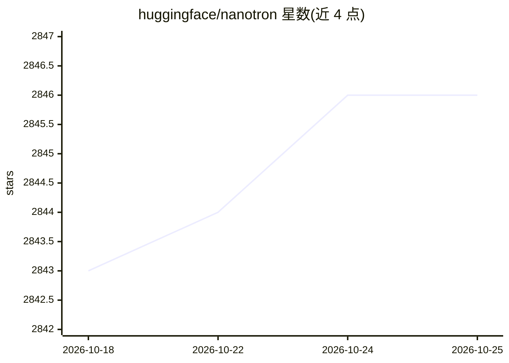

# huggingface/nanotron

⭐ 2,847 · Python · Apache-2.0 · 推送 2026-10-08 · [GitHub](https://github.com/huggingface/nanotron) · 组织维护

**面向研究者的极简 LLM 3D 并行预训练库**

Hugging Face 维护的 transformer 模型预训练库，提供简单灵活的 API 在自定义数据集上预训练模型，核心机制为 3D 并行（数据/张量/流水线并行）、专家并行、ZeRO-1 优化器、参数绑定与分片、CUDA 事件计时等；训练与生成脚本通过 torchrun 在多 GPU/多节点（Slurm）环境运行，附带 tiny Llama 快速上手示例及 Mamba、MoE、DoReMi 等扩展示例。FP8 训练、ZeRO-3、torch.compile 等在路线图中尚未支持。面向需要自行预训练 LLM 的研究者与工程师。

## 筛选速览

| 维度 | 判定 | 备注 |
|---|---|---|
| AI 角色 | `ai-ecosystem` | LLM/agent 周边工具 |
| 许可风险 | `permissive` | Apache-2.0 |
| 部署形态 | `library` | 以包/库形式分发 |
| 模型依赖 | — | README 未给出锁定关系 |
| 硬件要求 | — | 无带数字的原话,不猜 |
| 安装摩擦 | `high` | 编译与系统依赖俱全 |
| 成熟度 | — | 结构信号不足 |

## 能力要点

- 3D 并行（DP+TP+PP）与 MoE 专家并行训练
- ZeRO-1 优化器、参数绑定/分片、大模型自定义 checkpoint
- 从 checkpoint 直接运行生成（可调 TP/PP 加速）
- 附带 Mamba/MoE/DoReMi/µTransfer 等示例与多节点 Slurm 指南

## 适用场景

- 在自定义数据集上预训练 LLM
- 多节点多 GPU 扩展训练并做性能基准
- 复现/实验 MoE、Mamba 等架构的预训练

## 场景标签

`模型训练` · 领域:训练与推理

## 证据(README 行号)

> L18: Nanotron is a library for pretraining transformer models. It provides a simple and flexible API to pretrain models 
> L141: - [x] 3D parallelism (DP+TP+PP)

## 星数曲线

2026-10-18 2,843 → 2026-10-25 2,846（+3）

---
*卡片 v1 · prompt 1.4 · 生成 2026-10-21 · 置信度 high · 依据 README sha `63d306eb0003` · [字段定义](../../DATASET.md)*
