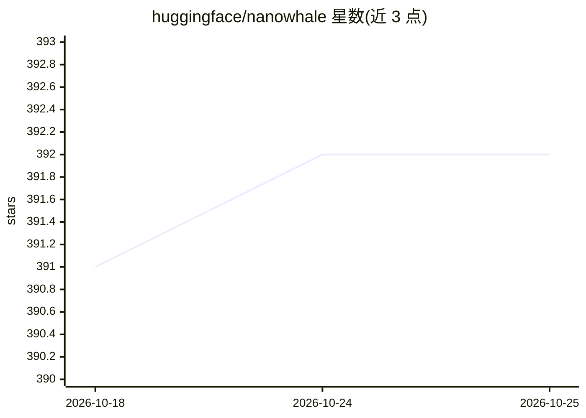

# huggingface/nanowhale

⭐ 392 · Python · 推送 2026-05-04 · [GitHub](https://github.com/huggingface/nanowhale) · 组织维护

**用 DeepSeek-V4 架构从零训练的 ~110M 小型语言模型**

Hugging Face 维护的微型语言模型项目：以 DeepSeek-V4 架构（MLA、MoE 4+1 专家、Hyper-Connections、MTP）在 110M 参数规模上从零预训练，含 base 与 SFT chat 两个模型权重，提供预训练/SFT/对话/评测脚本。预训练 5K 步消耗约 2.6B token（1× H100 80GB），SFT 后 token 准确率 48.5%。已知限制：bf16 下产生 NaN 需用 fp32，from_pretrained 会重初始化部分权重，129K 词表嵌入占 37% 参数。MIT 许可。

## 筛选速览

| 维度 | 判定 | 备注 |
|---|---|---|
| AI 角色 | `ai-native` | 本体是模型或模型工具 |
| 许可风险 | `none` | — |
| 部署形态 | `library` | 以包/库形式分发 |
| 模型依赖 | — | README 未给出锁定关系 |
| 硬件要求 | — | 无带数字的原话,不猜 |
| 安装摩擦 | `low` | 无编译、无系统依赖或容器化 |
| 成熟度 | — | 结构信号不足 |

## 能力要点

- 完整实现 DeepSeek-V4 特性集（MLA/MoE/Hyper-Connections/MTP）
- 提供 base 与 SFT chat 两个模型及全套训练脚本
- 附带预训练/SFT 训练指标与困惑度结果

## 适用场景

- 学习 DeepSeek-V4 架构的微型可复现实现
- 在小规模上做架构实验与消融研究
- 低成本运行从零训练的对话模型

## 场景标签

`模型训练` `教程课程` · 领域:学习与行业

## 证据(README 行号)

> L3: A ~110M parameter language model trained from scratch using the **DeepSeek-V4 architecture**. This repo contains all
> L9: |**nanowhale-100m-base**|Pretrained base model (5K steps on FineWeb-Edu)|🤗 Hub|
> L61: python scripts/chat.py

## 星数曲线

2026-10-18 391 → 2026-10-25 392（+1）

---
*卡片 v1 · prompt 1.4 · 生成 2026-10-21 · 置信度 high · 依据 README sha `14baabdd0bdd` · [字段定义](../../DATASET.md)*
