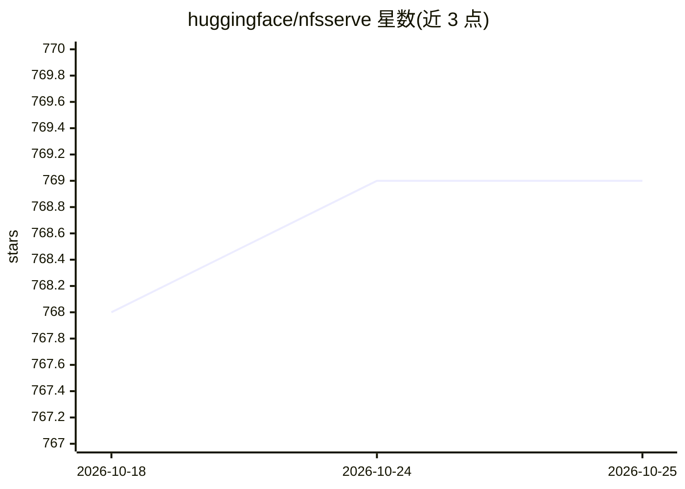

# huggingface/nfsserve

⭐ 770 · Rust · BSD-3-Clause · 推送 2026-10-20 · [GitHub](https://github.com/huggingface/nfsserve) · 组织维护

**给开发者：Rust 用户态 NFSv3 服务器库，实现跨平台挂载**

用 Rust 编写的 NFSv3 服务器实现（README 自称 incomplete but very functional），通过在 localhost 启动 NFS 服务器提供类 FUSE 的用户态文件系统 API：开发者实现 vfs::NFSFileSystem trait 即可让自己的文件系统被 Linux/macOS/Windows（Pro 版自带 NFS 客户端）挂载，避免 FUSE 的驱动安装负担。用于 Hugging Face hf-mount 功能。实现了 READDIR_PLUS 但未实现 READDIR，不支持链接创建，Windows 挂载部分可用。通过 cargo 构建运行示例。

## 筛选速览

| 维度 | 判定 | 备注 |
|---|---|---|
| AI 角色 | `ai-ecosystem` | LLM/agent 周边工具 |
| 许可风险 | `permissive` | BSD-3-Clause |
| 部署形态 | `desktop` | 安装包/桌面程序 |
| 模型依赖 | — | README 未给出锁定关系 |
| 硬件要求 | — | 无带数字的原话,不猜 |
| 安装摩擦 | `low` | 无编译、无系统依赖或容器化 |
| 成熟度 | `idea` | |

## 能力要点

- 实现 vfs::NFSFileSystem trait 即可提供可挂载文件系统
- 覆盖 NFS/Mount/Portmapper 协议的 XDR 编解码与 TCP RPC 处理
- Linux/Mac/Windows（Pro）挂载命令示例
- Mount 协议实现为无状态（仅 MNT 与 EXPORT）

## 适用场景

- 为自己的用户态文件系统提供跨平台挂载能力
- 不依赖 FUSE 驱动实现远程/虚拟文件系统访问
- 作为 NFSv3 协议与 XDR/RPC 实现的学习参考

## 场景标签

 · 领域:系统/文件系统基础设施

## 证据(README 行号)

> L1: Rust NFSv3 Server
> L22: This is used in hf-mount to provide the `hf-mount`

## 星数曲线

2026-10-18 768 → 2026-10-25 769（+1）

---
*卡片 v1 · prompt 1.4 · 生成 2026-10-21 · 置信度 high · 依据 README sha `cfb6913cbed0` · [字段定义](../../DATASET.md)*
