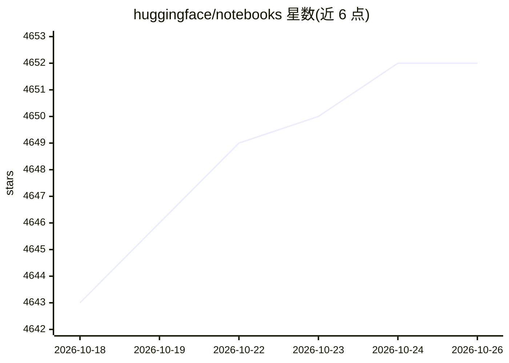

# huggingface/notebooks

⭐ 4,652 · Jupyter Notebook · Apache-2.0 · 推送 2026-10-22 · [GitHub](https://github.com/huggingface/notebooks) · 组织维护

**Hugging Face 官方库使用示例笔记本集合**

由 Hugging Face 维护的 notebooks 仓库，收录使用 Hugging Face 各库的示例 Jupyter 笔记本。README 仅两行，未列出具体库覆盖范围、分类结构或安装运行说明，具体内容需查看仓库目录。面向希望以可运行示例学习 HF 库用法的开发者与科研用户。因 README 信息极少，条目细节置信度受限。

## 筛选速览

| 维度 | 判定 | 备注 |
|---|---|---|
| AI 角色 | `ai-knowledge` | 知识聚合/清单类 |
| 许可风险 | `permissive` | Apache-2.0 |
| 部署形态 | `None` |  |
| 模型依赖 | — | README 未给出锁定关系 |
| 硬件要求 | — | 无带数字的原话,不猜 |
| 安装摩擦 | `low` | 无编译、无系统依赖或容器化 |
| 成熟度 | — | 结构信号不足 |

## 能力要点

- 由 Hugging Face 官方组织维护
- 收录基于 Hugging Face 库的示例 Jupyter 笔记本

## 适用场景

- 通过可运行的笔记本学习 Hugging Face 库的用法
- 查找官方示例作为项目起步代码

## 场景标签

`教程课程` · 领域:学习与行业

## 证据(README 行号)

> L1: # notebooks
> L2: Notebooks using the Hugging Face libraries 🤗

## 星数曲线

2026-10-18 4,643 → 2026-10-26 4,652（+9）

---
*卡片 v1 · prompt 1.4 · 生成 2026-10-20 · 置信度 low · 依据 README sha `dbca5342606e` · [字段定义](../../DATASET.md)*
