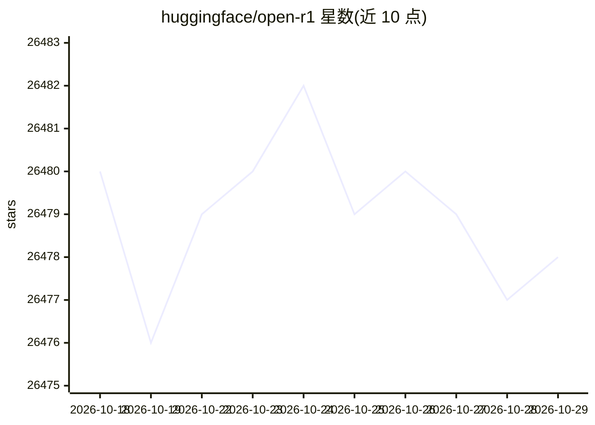

# huggingface/open-r1

⭐ 26,478 · Python · Apache-2.0 · 推送 2026-10-26 · [GitHub](https://github.com/huggingface/open-r1) · 组织维护

**复现 DeepSeek-R1 训练流程的开源项目**

以 DeepSeek-R1 技术报告为蓝本，提供三步复现路径：蒸馏复刻 R1-Distill 模型、纯 RL 管线（R1-Zero 路径）、多阶段训练。仓库包含 SFT、GRPO 训练脚本与基于 Distilabel 的合成数据生成脚本，配套 Makefile 快捷命令与 YAML 配方。已发布 Mixture-of-Thoughts（350k）、OpenR1-Math-220k、CodeForces-CoTs 等数据集。训练默认配置为 8×H100 节点，依赖 CUDA 12.4、vLLM 0.8.5.post1、PyTorch 2.6.0，多节点经 Slurm 调度。README 声明项目已停止维护，训练部分后续由 TRL 承接。

## 筛选速览

| 维度 | 判定 | 备注 |
|---|---|---|
| AI 角色 | `ai-ecosystem` | LLM/agent 周边工具 |
| 许可风险 | `permissive` | Apache-2.0 |
| 部署形态 | `library` | 以包/库形式分发 |
| 模型依赖 | local-ok | 支持本地模型 |
| 硬件要求 | — | 无带数字的原话,不猜 |
| 安装摩擦 | `high` | 编译与系统依赖俱全 |
| 成熟度 | — | 结构信号不足 |

## 动量与使用信号

- 维护:`active` — 距上次 push 16.2 天,年发版 0,44 位贡献者
- 涨星:近 1 天 **-2**(自 20261016 起算)
- 安装:pypi 包 `vllm` 月下载 1,857,414

## 能力要点

- 提供 sft.py/grpo.py/generate.py 覆盖 R1 流水线的训练与数据生成
- 发布 350k Mixture-of-Thoughts 与 OpenR1-Math-220k 等蒸馏推理数据集
- 支持 DDP 与 DeepSpeed ZeRO-2/3，GRPO 可经 TRL vLLM 后端多节点扩展
- 代码奖励函数支持 E2B 与 Morph 两种沙箱执行提供方

## 适用场景

- 按配方在自有数据上对模型做 SFT 蒸馏与 GRPO 强化训练
- 从 R1 蒸馏的推理轨迹数据集训练数学/代码推理模型
- 搭建多节点 Slurm 集群上的大规模 RL 训练

## 场景标签

`模型训练` `强化学习` `微调` · 领域:训练与推理

## 证据(README 行号)

> L7: *A fully open reproduction of DeepSeek-R1.*
> L25: The goal of this repo is to build the missing pieces of the R1 pipeline such that everybody can reproduce and build
> L103: We support training models with either DDP or DeepSpeed (ZeRO-2 and ZeRO-3). For example, to perform SFT on a data

## 星数曲线

2026-10-18 26,480 → 2026-10-29 26,478（-2）

---
*卡片 v1 · prompt 1.4 · 生成 2026-10-18 · 置信度 high · 依据 README sha `04c09e70dc3f` · [字段定义](../../DATASET.md)*
