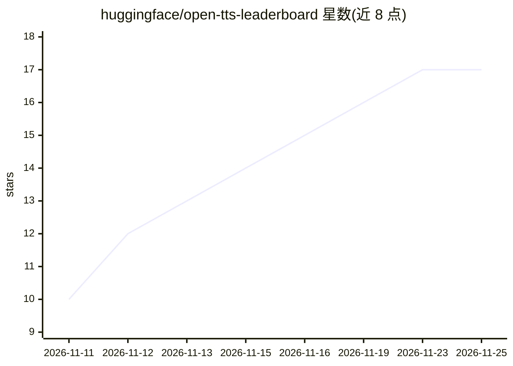

# huggingface/open-tts-leaderboard

⭐ 17 · Python · Apache-2.0 · 推送 2026-11-23 · [GitHub](https://github.com/huggingface/open-tts-leaderboard) · 组织维护

**Open TTS Leaderboard 的评测脚本：批量评测 TTS 模型并发布榜单**

Hugging Face 维护的 TTS 模型评测流水线：通过 HF Jobs 在远程 GPU 上按序执行生成、转写、说话人相似度、UTMOS/KOMOS 打分等阶段，随后在本地计算 WER/CER、RTFx、SIM 与预测 MOS 并写入结果 bucket，可用 open_results_pr.py 向榜单仓库提交 PR。覆盖 Seed TTS Eval、CV3、MiniMax、Neyshekar 四个数据集，多个语言。使用者需 HF 账号、付费额度与私有数据集副本；被评测模型可运行在自己的 Docker Space 或公共镜像上。README 给出全流程运行步骤与费用示例。

## 筛选速览

| 维度 | 判定 | 备注 |
|---|---|---|
| AI 角色 | `ai-ecosystem` | LLM/agent 周边工具 |
| 许可风险 | `permissive` | Apache-2.0 |
| 部署形态 | `self-host` | docker 或自建部署 |
| 模型依赖 | — | README 未给出锁定关系 |
| 硬件要求 | — | 无带数字的原话,不猜 |
| 安装摩擦 | `low` | 无编译、无系统依赖或容器化 |
| 成熟度 | — | 结构信号不足 |

## 能力要点

- 四阶段 HF Jobs 流水线：生成→ASR 转写→说话人相似度→UTMOS/KOMOS 打分
- 客观指标：WER/CER、RTFx/TTFA、WavLM 说话人相似度、预测 MOS
- 支持 4 个评测数据集与十余种语言（部分数据集需自建私有副本）
- open_results_pr.py 评分并对榜单结果仓库开 PR

## 适用场景

- 为 TTS 模型复现或新增 Open TTS Leaderboard 榜单条目
- 在统一硬件（H200/L4）上对比多个 TTS 模型的可懂度与速度
- 以客观指标代替人工投票快速评测新发布的 TTS 模型

## 场景标签

`模型评测` `语音合成` · 领域:评测与运维

## 证据(README 行号)

> L3: This repository contains the code for the Open TTS Leaderboard. The leaderboard is a Gradio Space that allows users 
> L5: Hugging Face Jobs are used to launch evaluations in a reproducible manner. Each model family contains its own model 
> L15: 1. **Intelligibility**: word/character error rate (WER and CER) between the target text and the generated audio's t

## 星数曲线

2026-11-11 10 → 2026-11-25 17（+7）

---
*卡片 v1 · prompt 1.4 · 生成 2026-11-18 · 置信度 mid · 依据 README sha `2bb1b1db9f78` · [字段定义](../../DATASET.md)*
