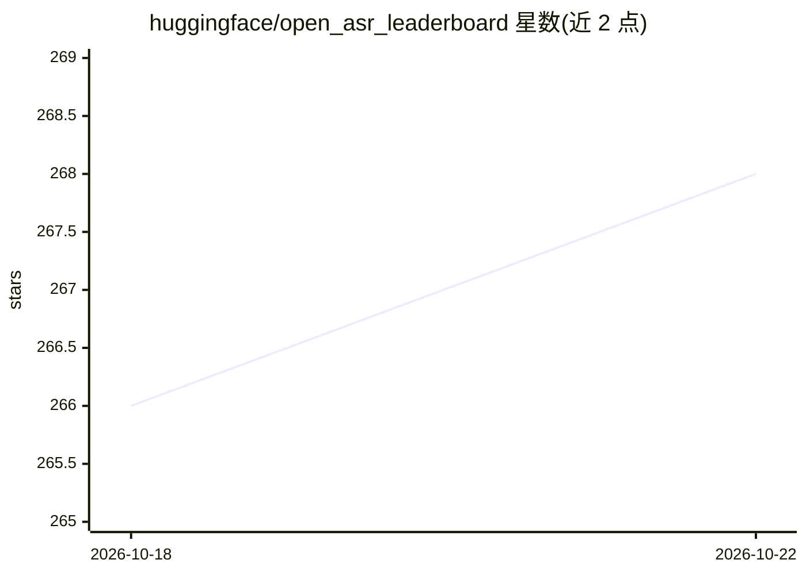

# huggingface/open_asr_leaderboard

⭐ 268 · Python · Apache-2.0 · 推送 2026-10-21 · [GitHub](https://github.com/huggingface/open_asr_leaderboard) · 组织维护

**语音识别（ASR）模型评测排行榜：多数据集比较模型准确率**

由 Hugging Face 维护的开源 ASR 排行榜代码库，以 Gradio Space 形式托管，用于在多套公开基准（英文短音频、长音频、多语种、分块会议级参考）上比较 ASR 模型的 WER 等指标。评测通过 HF Jobs 在固定硬件（H200）上以 Docker 镜像运行以保证可复现性；每类模型家族有独立 Docker 镜像与 run_eval.py 入口，也可本地评测。另提供 RTFx-WER 权衡图脚本与基准过拟合检测脚本。提交模型由维护者在私有测试集上评测。

## 筛选速览

| 维度 | 判定 | 备注 |
|---|---|---|
| AI 角色 | `ai-ecosystem` | LLM/agent 周边工具 |
| 许可风险 | `permissive` | Apache-2.0 |
| 部署形态 | `self-host` | docker 或自建部署 |
| 模型依赖 | — | README 未给出锁定关系 |
| 硬件要求 | — | 无带数字的原话,不猜 |
| 安装摩擦 | `low` | 无编译、无系统依赖或容器化 |
| 成熟度 | — | 结构信号不足 |

## 能力要点

- 覆盖英文短音频/长音频/多语种/分块会议级等多套公开基准
- HF Jobs 固定硬件 + Docker 镜像运行，保证评测可复现
- 每类模型家族独立 run_eval.py 入口，输出 JSONL 预测与 WER/RTFx
- 提供 RTFx vs WER 权衡图与基准过拟合检测脚本

## 适用场景

- 对比各 ASR 模型在我关心的数据集上的 WER 表现
- 提交自己的 ASR 模型参与标准化评测
- 在本地复现或预跑评测后再提交排行榜

## 场景标签

 · 领域:语音识别/模型评测

## 证据(README 行号)

> L3: This repository contains the code for the Open ASR Leaderboard. The leaderboard is a Gradio Space that allows users 
> L24: # Evaluate a model (as of 24 July 2026)

## 星数曲线

2026-10-18 266 → 2026-10-22 268（+2）

---
*卡片 v1 · prompt 1.4 · 生成 2026-10-22 · 置信度 high · 依据 README sha `eaf331d2394b` · [字段定义](../../DATASET.md)*
