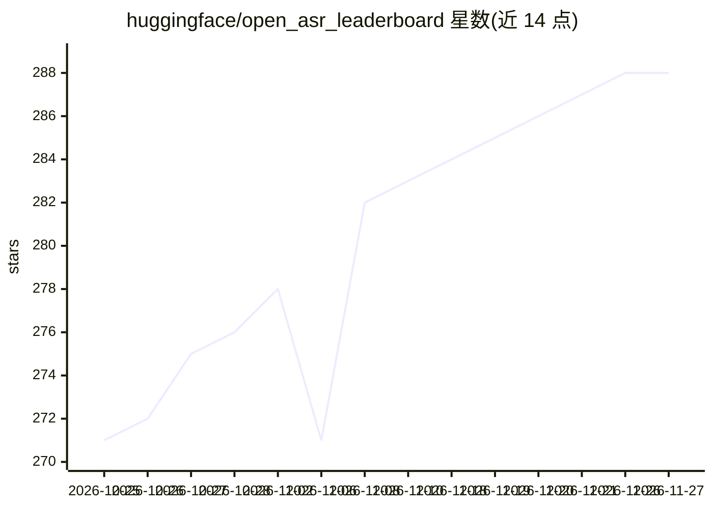

# huggingface/open_asr_leaderboard

⭐ 288 · Python · Apache-2.0 · 推送 2026-11-26 · [GitHub](https://github.com/huggingface/open_asr_leaderboard) · 组织维护

**ASR 模型准确率公开排行榜：跨数据集对比语音识别模型**

Hugging Face 上的 Gradio Space，将 ASR 模型在多组公开基准上按 WER/CER、CTEM 等指标对比。评估通过 Hugging Face Jobs 在固定 Docker 镜像与固定硬件（1x H200）上运行以保证可复现性；模型按家族提供 Docker 镜像与 run_eval.py 入口，输出 JSONL 预测与 WER/RTFx。覆盖英文短/长音频、多语言（FLEURS/MCV/MLS 等）及 VoiceCodeBench 实体恢复，并提供基准拟合检测脚本；评测需 HF 账号、额度与存储桶。

## 筛选速览

| 维度 | 判定 | 备注 |
|---|---|---|
| AI 角色 | `ai-knowledge` | 知识聚合/清单类 |
| 许可风险 | `permissive` | Apache-2.0 |
| 部署形态 | `self-host` | docker 或自建部署 |
| 模型依赖 | — | README 未给出锁定关系 |
| 硬件要求 | — | 无带数字的原话,不猜 |
| 安装摩擦 | `low` | 无编译、无系统依赖或容器化 |
| 成熟度 | — | 结构信号不足 |

## 能力要点

- 多域多语言 ASR 基准评测（英文短/长音频、多语言、实体恢复）
- HF Jobs + 固定 Docker 镜像与固定硬件保证可复现
- VoiceCodeBench 的 CTEM 实体恢复评分（Qwen3.8-27B 评审）
- 规范化变更后可对已有 JSONL 结果重打分，无需重跑推理

## 适用场景

- 为新语音识别模型提交排行榜评测
- 对比不同 ASR 模型在多种数据集上的准确率
- 检测测试集是否对某模型存在基准拟合

## 场景标签

`模型评测` `语音识别` · 领域:评测与运维

## 证据(README 行号)

> L3: This repository contains the code for the Open ASR Leaderboard. The leaderboard is a Gradio Space that allows users 
> L7: The Open ASR Leaderboard evaluates models on a diverse set of publicly available ASR benchmarks hosted on the Huggin
> L29: English short-form, English long-form, and multilingual evaluations use Hugging Face Jobs to guarantee reproducibil

## 星数曲线

2026-10-25 271 → 2026-11-27 288（+17）

---
*卡片 v1 · prompt 1.4 · 生成 2026-11-27 · 置信度 high · 依据 README sha `9e39ef848682` · [字段定义](../../DATASET.md)*
