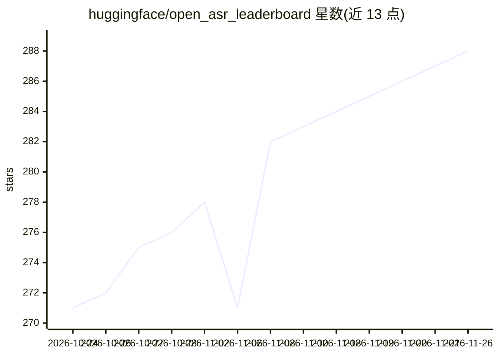

# huggingface/open_asr_leaderboard

⭐ 288 · Python · Apache-2.0 · 推送 2026-11-25 · [GitHub](https://github.com/huggingface/open_asr_leaderboard) · 组织维护

**面向研究者与开发者的开源 ASR 模型精度排行榜及其评测代码**

该仓库包含 Open ASR Leaderboard 的代码，以 Gradio Space 形式托管在 Hugging Face 上，用于比较 ASR 模型在多数据集上的准确率。评测覆盖英语短音频、长音频与多语言基准（中文按 CER 计分），通过 HF Jobs 在统一 Docker 镜像与固定硬件上运行以保证可复现性；每个模型族有各自的 Docker 镜像、run_eval.py 入口与提交脚本，输出 JSONL 预测与 WER/RTFx 指标。还提供基准拟合检测脚本与 WER-RTFx 权衡图。

## 筛选速览

| 维度 | 判定 | 备注 |
|---|---|---|
| AI 角色 | `ai-ecosystem` | LLM/agent 周边工具 |
| 许可风险 | `permissive` | Apache-2.0 |
| 部署形态 | `self-host` | docker 或自建部署 |
| 模型依赖 | — | README 未给出锁定关系 |
| 硬件要求 | — | 无带数字的原话,不猜 |
| 安装摩擦 | `low` | 无编译、无系统依赖或容器化 |
| 成熟度 | — | 结构信号不足 |

## 能力要点

- 覆盖英语短音频、长音频与多语言（含中文 CER）三套基准
- HF Jobs 统一 Docker 镜像与硬件保证评测可复现
- 按模型族提供 run_eval.py 与 submit_jobs 脚本，输出 WER 与 RTFx
- 提供 benchmark_fitting 脚本检测模型对测试集的过拟合

## 适用场景

- 为项目选型 ASR 模型时对比各模型的 WER/RTFx
- 以可复现流程自行评测并提交新的 ASR 模型
- 检测候选模型是否对基准测试集过拟合

## 场景标签

`模型评测` · 领域:评测与运维

## 证据(README 行号)

> L3: This repository contains the code for the Open ASR Leaderboard. The leaderboard is a Gradio Space that allows users 
> L26: English short-form, English long-form, and multilingual evaluations use Hugging Face Jobs to guarantee reproducibil
> L77: Each model family has a `run_eval.py` entry point, launched on HF Jobs by a `submit_jobs*.sh` script (e.g. `transfo

## 星数曲线

2026-10-24 271 → 2026-11-26 288（+17）

---
*卡片 v1 · prompt 1.4 · 生成 2026-11-25 · 置信度 mid · 依据 README sha `e676fb3c647d` · [字段定义](../../DATASET.md)*
