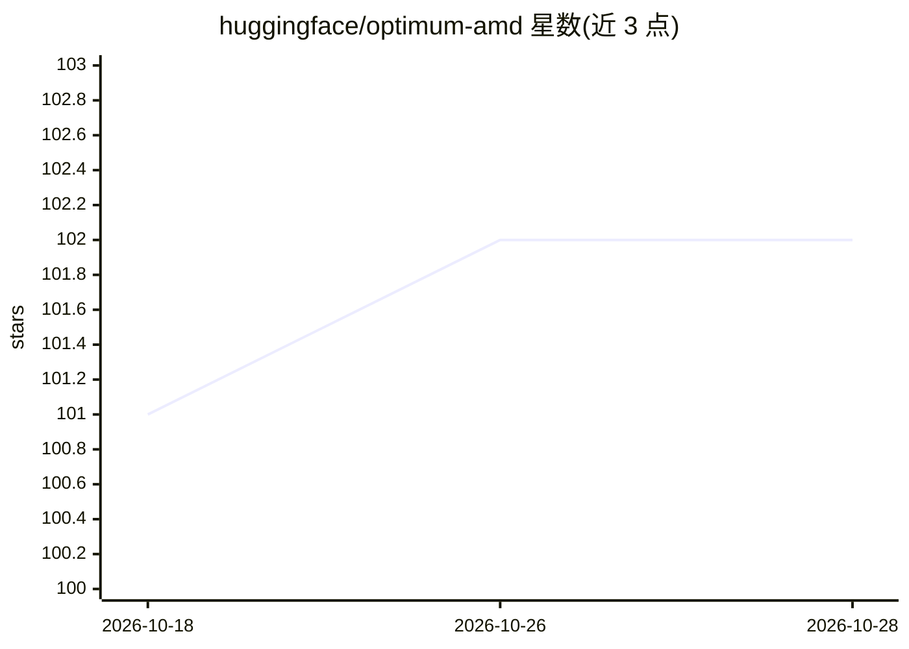

# huggingface/optimum-amd

⭐ 102 · Jupyter Notebook · MIT · 推送 2026-10-14 · [GitHub](https://github.com/huggingface/optimum-amd) · [官网](https://huggingface.co/docs/optimum/amd/index) · 组织维护

**AMD 硬件上的 Transformers 模型优化扩展库（ROCm GPU/Ryzen AI NPU）**

Hugging Face Optimum 的 AMD 扩展：为 AMD GPU（ROCm）与 Ryzen AI NPU 提供加载与推理接口。ROCm 部分说明 PyTorch/Transformers/TGI 在 AMD Instinct MI210/MI250 上的原生支持路径（含 Docker 部署示例）与 ONNX Runtime ROCmExecutionProvider 用法；Ryzen AI 部分提供 RyzenAIModelForXxx 类替换 AutoModelForXxx 加载量化 ONNX 模型在 NPU 上推理，需先启用 Ryzen AI 环境。面向在 AMD 硬件上部署 HF 模型的开发者，pip 安装或源码安装。

## 筛选速览

| 维度 | 判定 | 备注 |
|---|---|---|
| AI 角色 | `ai-ecosystem` | LLM/agent 周边工具 |
| 许可风险 | `permissive` | MIT |
| 部署形态 | `self-host` | docker 或自建部署 |
| 模型依赖 | — | README 未给出锁定关系 |
| 硬件要求 | — | 无带数字的原话,不猜 |
| 安装摩擦 | `low` | 无编译、无系统依赖或容器化 |
| 成熟度 | — | 结构信号不足 |

## 能力要点

- 为 ROCm AMD GPU 与 Ryzen AI NPU 提供性能优化接口
- RyzenAIModelForXxx 类直接替换 AutoModelForXxx 即可在 NPU 推理
- TGI 在 MI210/MI250 上的 Docker 部署示例
- ONNX Runtime ROCmExecutionProvider 与 Vitis AI EP 支持

## 适用场景

- 在 AMD Instinct GPU 上部署 LLM 推理服务
- 在 Ryzen AI 笔记本 NPU 上本地运行量化 HF 模型
- 为 ONNX 模型做量化后在 AMD 硬件推理

## 场景标签

`推理引擎` · 领域:训练与推理

## 证据(README 行号)

> L3: 🤗 Optimum-AMD is an extension to Hugging Face libraries enabling performance optimizations for ROCm for AMD GPUs and
> L70: Optimum-AMD provides easy interface for loading and inference of Hugging Face models on Ryzen AI accelerator.

## 星数曲线

2026-10-18 101 → 2026-10-28 102（+1）

---
*卡片 v1 · prompt 1.4 · 生成 2026-10-23 · 置信度 mid · 依据 README sha `0a7bd2964a73` · [字段定义](../../DATASET.md)*
