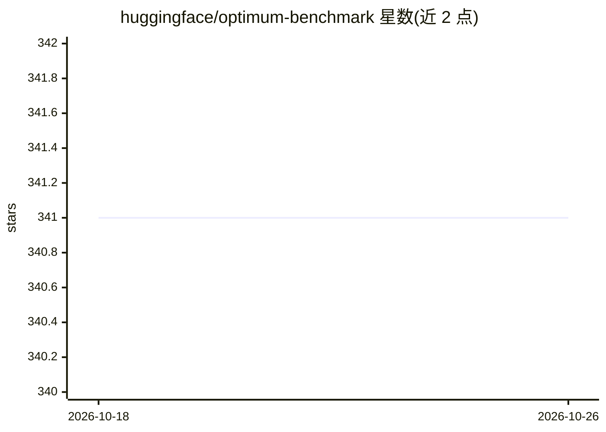

# huggingface/optimum-benchmark

⭐ 341 · Python · Apache-2.0 · 推送 2026-10-14 · [GitHub](https://github.com/huggingface/optimum-benchmark) · 组织维护

**多后端多硬件的模型推理/训练基准测试工具**

HuggingFace 维护的统一基准测试工具，面向 Transformers、Diffusers、PEFT、TIMM 及 Optimum 系列库，支持推理与训练场景下衡量延迟、吞吐、内存与能耗。支持 PyTorch、ONNXRuntime、OpenVINO、TensorRT-LLM、vLLM、Neural Compressor、IPEX、Py-TXI、LlamaCpp 等后端，覆盖 CPU/CUDA/ROCM/XPU 等设备，通过 Hydra CLI 或 Python API 运行单次或扫描式基准。提供 pip 安装与 cpu/cuda/rocm 三类 docker 镜像。README 自述为进行中项目、尚不适用于生产环境。

## 筛选速览

| 维度 | 判定 | 备注 |
|---|---|---|
| AI 角色 | `ai-ecosystem` | LLM/agent 周边工具 |
| 许可风险 | `permissive` | Apache-2.0 |
| 部署形态 | `library` | 以包/库形式分发 |
| 模型依赖 | local-ok | 支持本地模型 |
| 硬件要求 | — | 无带数字的原话,不猜 |
| 安装摩擦 | `medium` | 含编译或系统依赖之一 |
| 成熟度 | `idea` | |

## 能力要点

- 9+ 种后端（PyTorch/ONNXRuntime/OpenVINO/TensorRT-LLM/vLLM/LlamaCpp 等）跨 CPU/CUDA/ROCM/XPU 设备
- 推理/训练场景的延迟、吞吐、内存、能耗跟踪
- Hydra CLI 支持配置覆盖与多设备扫描运行
- no_weights 特性可用随机初始化权重测试模型，无需下载权重

## 适用场景

- 对比不同硬件平台上同一模型的推理性能
- 评估不同量化与优化方案对延迟/内存/能耗的影响
- 为模型选型比较多个后端的吞吐与延迟

## 场景标签

`模型评测` · 领域:评测与运维

## 证据(README 行号)

> L11: Optimum-Benchmark is a unified multi-backend & multi-device utility for benchmarking Transformers, Diffusers, PEFT,
> L200: `optimum-benchmark` allows you to run benchmarks with minimal configuration. A benchmark is defined by three main 

## 星数曲线

2026-10-18 341 → 2026-10-26 341（+0）

---
*卡片 v1 · prompt 1.4 · 生成 2026-10-21 · 置信度 high · 依据 README sha `9d92fdce2435` · [字段定义](../../DATASET.md)*
