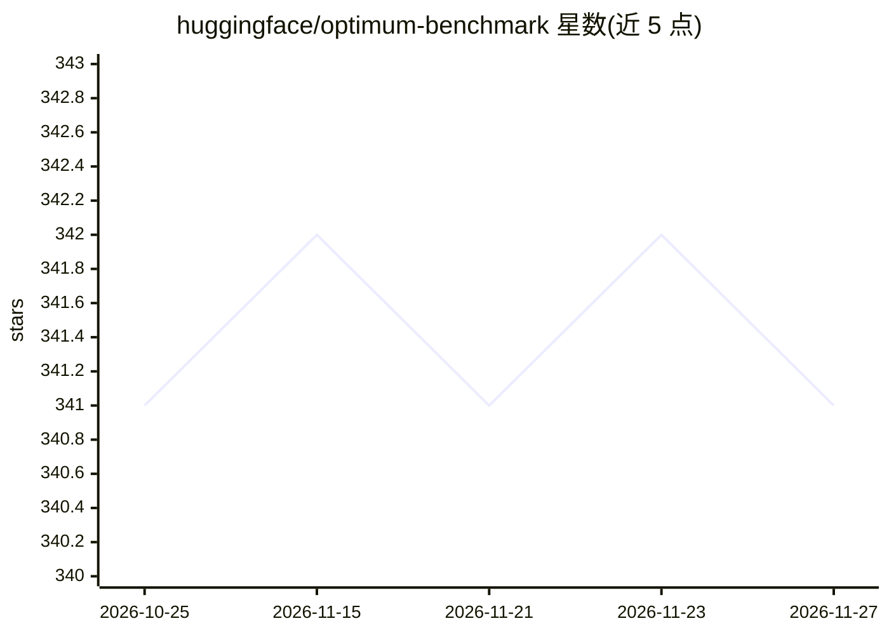

# huggingface/optimum-benchmark

⭐ 341 · Python · Apache-2.0 · 推送 2026-11-10 · [GitHub](https://github.com/huggingface/optimum-benchmark) · 组织维护

**给 HuggingFace 生态用户做多后端推理/训练性能基准测试**

面向 HuggingFace 生态用户与硬件合作伙伴的基准测试工具：对 Transformers、Diffusers、PEFT、Timm 等库的模型，在多后端（PyTorch、ONNXRuntime、OpenVINO、TensorRT-LLM、vLLM、Neural Compressor、Py-TXI、llama.cpp）与多设备（CPU/CUDA/ROCm）上测量延迟、吞吐、内存与能耗。基准由 launcher/scenario/backend 三要素定义，通过 Hydra CLI 或 Python API 运行，支持配置覆盖与 multirun 扫描，输出 JSON/Markdown 报告；提供 cpu/cuda/rocm Docker 镜像用于复现。README 注明项目仍在开发中，尚未可用于生产。

## 筛选速览

| 维度 | 判定 | 备注 |
|---|---|---|
| AI 角色 | `ai-ecosystem` | LLM/agent 周边工具 |
| 许可风险 | `permissive` | Apache-2.0 |
| 部署形态 | `library` | 以包/库形式分发 |
| 模型依赖 | local-ok | 支持本地模型 |
| 硬件要求 | — | 无带数字的原话,不猜 |
| 安装摩擦 | `medium` | 含编译或系统依赖之一 |
| 成熟度 | `idea` | |

## 能力要点

- 多后端基准测试：PyTorch/ONNXRuntime/OpenVINO/TensorRT-LLM/vLLM/Neural Compressor/Py-TXI/llama.cpp
- 测量延迟、吞吐、内存与能耗，支持训练与推理两种场景
- Hydra CLI 支持配置覆盖与 multirun 扫描，Python API 支持隔离与分布式基准
- 提供 cpu/cuda/rocm 四个 Docker 镜像用于测试与复现

## 适用场景

- 对比不同模型在延迟、吞吐、内存、能耗上的表现
- 硬件厂商评估自家硬件在相同模型上的性能
- 测试量化与优化方案对推理/训练效率的影响
- 为 LLM 性能榜单类项目采集可复现的基准数据

## 场景标签

`模型评测` · 领域:评测与运维

## 证据(README 行号)

> L11: Optimum-Benchmark is a unified multi-backend & multi-device utility for benchmarking Transformers, Diffusers, PEFT,
> L199: - The launcher to use (e.g. `process`)
> L240: ### Backends & Devices 📱

## 星数曲线

2026-10-25 341 → 2026-11-27 341（+0）

---
*卡片 v1 · prompt 1.4 · 生成 2026-11-25 · 置信度 high · 依据 README sha `eaeec3ec6825` · [字段定义](../../DATASET.md)*
