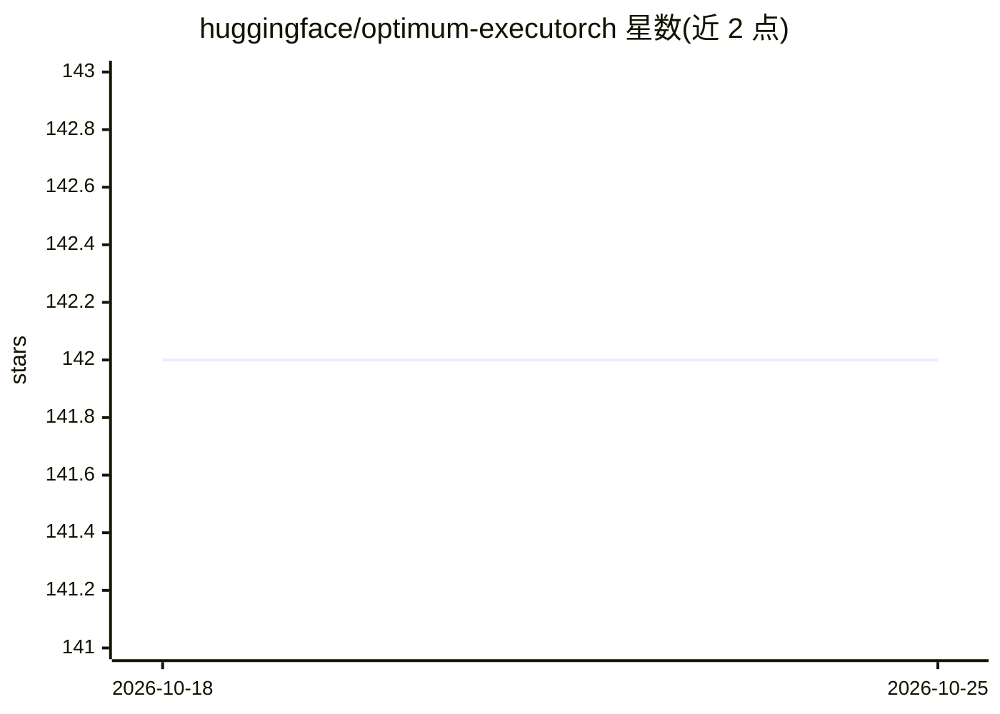

# huggingface/optimum-executorch

⭐ 142 · Python · Apache-2.0 · 推送 2026-10-14 · [GitHub](https://github.com/huggingface/optimum-executorch) · [官网](https://huggingface.co/docs/optimum-executorch/en/index) · 组织维护

**把 Hugging Face 模型转换为 ExecuTorch 格式以部署到边缘设备**

Hugging Face 官方维护的模型导出与部署工具：将 Transformers 模型转换为 ExecuTorch 的 .pte 格式，提供一站式 Python API 与 optimum-cli 导出两种使用方式，导出后可在 CPU、iOS/Android 设备上运行推理。提供基于 Flash Attention 的自定义 SDPA 与自定义 KV cache 算子、XNNPACK（CPU）与 CoreML（Apple GPU）后端委派、基于 TorchAO 的训练后量化。已测试模型覆盖 LLM、NLU、视觉与语音模型（Llama、Qwen、Whisper 等）。需从源码安装，PyPI 安装尚未发布。

## 筛选速览

| 维度 | 判定 | 备注 |
|---|---|---|
| AI 角色 | `ai-ecosystem` | LLM/agent 周边工具 |
| 许可风险 | `permissive` | Apache-2.0 |
| 部署形态 | `library` | 以包/库形式分发 |
| 模型依赖 | — | README 未给出锁定关系 |
| 硬件要求 | — | 无带数字的原话,不猜 |
| 安装摩擦 | `low` | 无编译、无系统依赖或容器化 |
| 成熟度 | — | 结构信号不足 |

## 能力要点

- HF 模型一键转换为 ExecuTorch .pte 格式（Python API 与 CLI）
- 自定义 SDPA 与 KV cache 算子、TorchAO 训练后量化
- XNNPACK（CPU）与 CoreML（Apple GPU）后端委派
- 支持 LLM/NLU/视觉/语音等多类已测试模型并提供移动端 decode 基准

## 适用场景

- 把 Llama/Qwen 等模型导出后在手机上离线运行
- 对模型做量化后部署到 CPU 或 Apple GPU 后端
- 利用 Hub 预缓存 .pte 文件跳过导出步骤快速加载

## 场景标签

`模型量化` `推理引擎` · 领域:训练与推理

## 证据(README 行号)

> L9: Optimum ExecuTorch enables efficient deployment of transformer models using Meta's ExecuTorch framework. It provides
> L10: - 🔄 Easy conversion of Hugging Face models to ExecuTorch format
> L11: - ⚡ Optimized inference with hardware-specific optimizations

## 星数曲线

2026-10-18 142 → 2026-10-25 142（+0）

---
*卡片 v1 · prompt 1.4 · 生成 2026-10-22 · 置信度 mid · 依据 README sha `8993eaf17956` · [字段定义](../../DATASET.md)*
