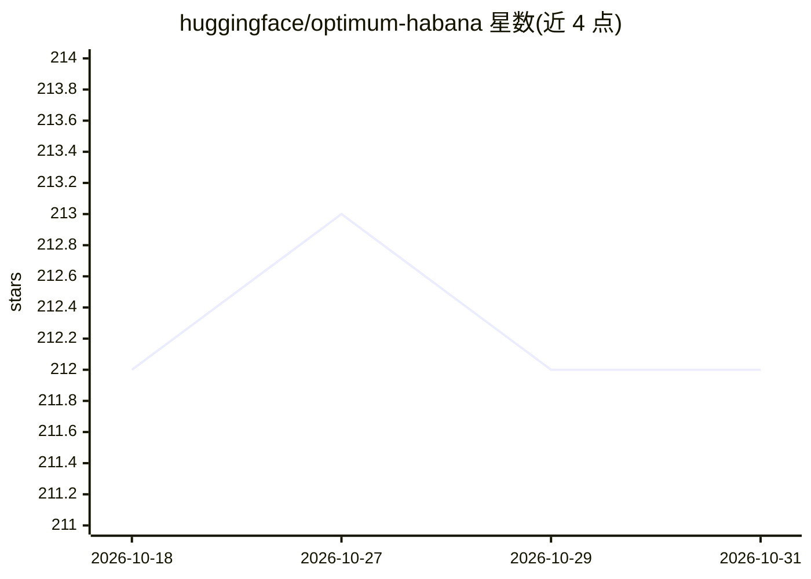

# huggingface/optimum-habana

⭐ 212 · Python · Apache-2.0 · 推送 2026-10-28 · [GitHub](https://github.com/huggingface/optimum-habana) · 组织维护

**让 Transformers/Diffusers 在 Intel Gaudi HPU 上训练与推理的接口库**

Optimum for Intel Gaudi（optimum-habana）是 Hugging Face Optimum 系列中面向 Intel Gaudi AI 加速器（HPU）的接口库，为 Transformers 与 Diffusers 提供模型加载、训练与推理工具，支持单卡与多卡及 DeepSpeed 分布式。核心机制是 GaudiTrainer/GaudiConfig（可从 Transformers Trainer 替换迁移）与面向 Stable Diffusion 的 GaudiStableDiffusionPipeline；README 附带大量已验证模型清单。注意：官方声明自 2026-10-31 起停止支持，最终版本 v1.21.2，无官方推荐替代品。

## 筛选速览

| 维度 | 判定 | 备注 |
|---|---|---|
| AI 角色 | `ai-ecosystem` | LLM/agent 周边工具 |
| 许可风险 | `permissive` | Apache-2.0 |
| 部署形态 | `library` | 以包/库形式分发 |
| 模型依赖 | — | README 未给出锁定关系 |
| 硬件要求 | — | 无带数字的原话,不猜 |
| 安装摩擦 | `medium` | 含编译或系统依赖之一 |
| 成熟度 | — | 结构信号不足 |

## 能力要点

- GaudiTrainer/GaudiConfig 支持单卡与多卡训练、评估与混合精度配置
- GaudiStableDiffusionPipeline/GaudiDDIMScheduler 在 HPU 上运行 Diffusers
- 覆盖 Transformers、Diffusers、TIMM 多类已验证模型清单
- 已宣布停止官方支持（最终版 v1.21.2，无推荐替代）

## 适用场景

- 把现有 Transformers 训练脚本迁移到 Gaudi HPU 上运行
- 在 Gaudi 加速器上做 Stable Diffusion 文生图/图生视频
- 查某模型架构在 HPU 上训练/推理的验证状态

## 场景标签

`微调` `推理引擎` · 领域:训练与推理

## 证据(README 行号)

> L19: Optimum for Intel Gaudi - a.k.a. `optimum-habana` - is the interface between the Transformers and Diffusers librari
> L20: Intel Gaudi AI Accelerators (HPU). It provides a set of tools enabling easy
> L21: model loading, training and inference on single- and multi-HPU settings for different downstream tasks. The list of

## 星数曲线

2026-10-18 212 → 2026-10-31 212（+0）

---
*卡片 v1 · prompt 1.4 · 生成 2026-10-22 · 置信度 high · 依据 README sha `3cf0786a15e9` · [字段定义](../../DATASET.md)*
