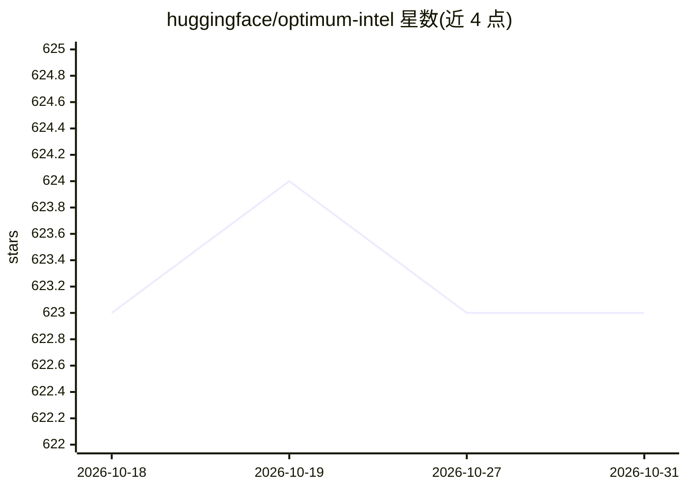

# huggingface/optimum-intel

⭐ 623 · Jupyter Notebook · Apache-2.0 · 推送 2026-10-30 · [GitHub](https://github.com/huggingface/optimum-intel) · [官网](https://huggingface.co/docs/optimum-intel/en/index) · 组织维护

**Hugging Face 库接入 OpenVINO：在 Intel 硬件上加速模型推理**

Transformers、Diffusers、Sentence Transformers 与 timm 库和 OpenVINO 工具链之间的接口层：把模型导出为 OpenVINO IR 格式、用 OpenVINO Runtime 运行推理，并支持静态后训练量化（含 Whisper 语音模型示例）与剪枝、知识蒸馏等压缩技术的工具配套。面向在 Intel CPU/GPU/DL 加速器上部署 Hugging Face 模型的开发者，以 pip 安装的 Python 库形式提供，另带 optimum-cli 命令行工具和 notebooks 示例目录。

## 筛选速览

| 维度 | 判定 | 备注 |
|---|---|---|
| AI 角色 | `ai-ecosystem` | LLM/agent 周边工具 |
| 许可风险 | `permissive` | Apache-2.0 |
| 部署形态 | `library` | 以包/库形式分发 |
| 模型依赖 | — | README 未给出锁定关系 |
| 硬件要求 | — | 无带数字的原话,不猜 |
| 安装摩擦 | `low` | 无编译、无系统依赖或容器化 |
| 成熟度 | — | 结构信号不足 |

## 能力要点

- 将 HF 模型导出为 OpenVINO IR 格式（optimum-cli export openvino）
- 以 OVModelForXxx 类替换 AutoModelForXxx 直接运行推理
- 静态后训练量化，示例覆盖 Whisper 语音模型
- 可通过 Hub Space 在线完成模型转换并推送仓库

## 适用场景

- 把 Hugging Face 模型转成 OpenVINO 格式在 Intel CPU/GPU 上部署
- 对 LLM、ASR、TTS、视觉等模型做量化压缩以加速推理
- 在 notebook 中试验模型优化与推理加速流程

## 场景标签

`推理引擎` `模型量化` · 领域:训练与推理

## 证据(README 行号)

> L3: 🤗 Optimum Intel is the interface between the 🤗 Transformers, Diffusers, Sentence Transformers and timm libraries and
> L5: OpenVINO is an open-source toolkit that enables high performance inference capabilities for Intel CPUs, GPUs, and sp

## 星数曲线

2026-10-18 623 → 2026-10-31 623（+0）

---
*卡片 v1 · prompt 1.4 · 生成 2026-10-21 · 置信度 high · 依据 README sha `96d66a109904` · [字段定义](../../DATASET.md)*
