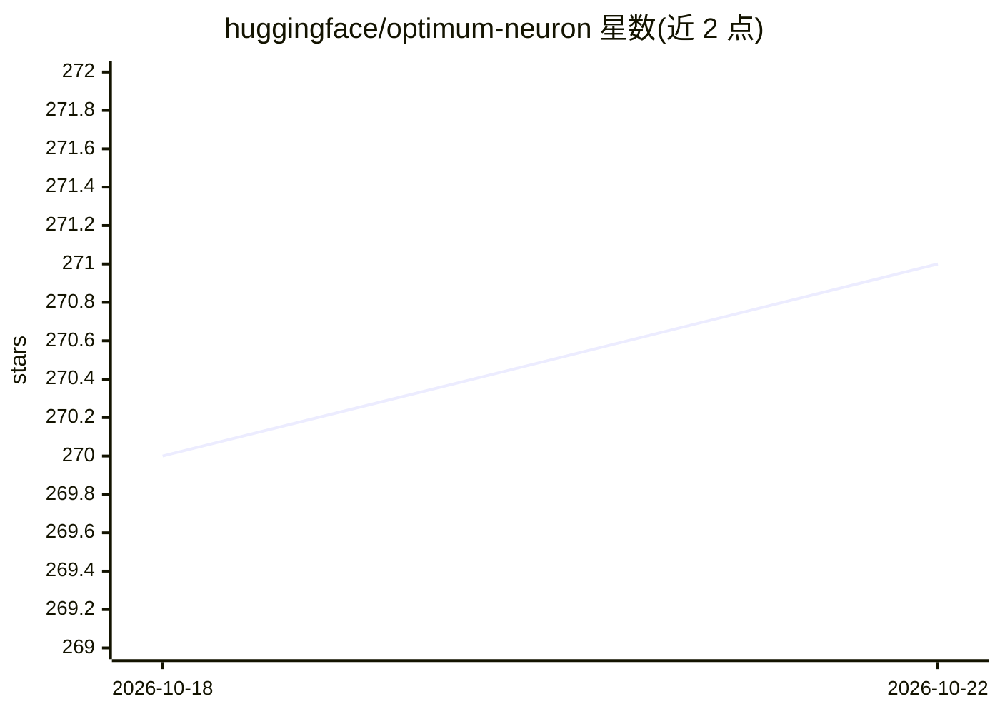

# huggingface/optimum-neuron

⭐ 271 · Jupyter Notebook · Apache-2.0 · 推送 2026-10-14 · [GitHub](https://github.com/huggingface/optimum-neuron) · 组织维护

**让 Transformers 模型在 AWS Trainium/Inferentia 上训练与推理的接口库**

Hugging Face 维护的 Transformers 与 AWS 加速器（Trainium/Inferentia）之间的接口库：以 drop-in replacement 方式替换标准 Transformers 训练与推理组件，提供 NeuronSFTTrainer、NeuronModelForXXX 等类做分布式训练与编译导出推理；可用 optimum-cli 将模型导出为静态 shape 的序列化 Neuron 格式。pip 安装，需先装 Neuron 驱动与工具，面向在 AWS 加速器上部署模型的开发者。

## 筛选速览

| 维度 | 判定 | 备注 |
|---|---|---|
| AI 角色 | `ai-ecosystem` | LLM/agent 周边工具 |
| 许可风险 | `permissive` | Apache-2.0 |
| 部署形态 | `library` | 以包/库形式分发 |
| 模型依赖 | local-ok | 支持本地模型 |
| 硬件要求 | — | 无带数字的原话,不猜 |
| 安装摩擦 | `low` | 无编译、无系统依赖或容器化 |
| 成熟度 | — | 结构信号不足 |

## 能力要点

- 标准 Transformers 训练/推理的 drop-in replacement
- 最少代码改动的分布式训练支持
- optimum-cli 导出编译后的 Neuron 模型（静态 shape、BF16 转换）
- 可选 vllm 推理组件安装

## 适用场景

- 把现有 Transformers 微调代码迁移到 Trainium 上运行
- 将模型编译导出后在 Inferentia 上做推理
- 在 AWS 加速器实例上做 LLM 监督微调

## 场景标签

 · 领域:机器学习基础设施

## 证据(README 行号)

> L3: 🤗 Optimum Neuron is the interface between the 🤗 Transformers library and AWS Accelerators including AWS Trainium and
> L5: - 🔄 **Drop-in replacement** for standard Transformers training and inference

## 星数曲线

2026-10-18 270 → 2026-10-22 271（+1）

---
*卡片 v1 · prompt 1.4 · 生成 2026-10-22 · 置信度 high · 依据 README sha `6befbc3e54fa` · [字段定义](../../DATASET.md)*
