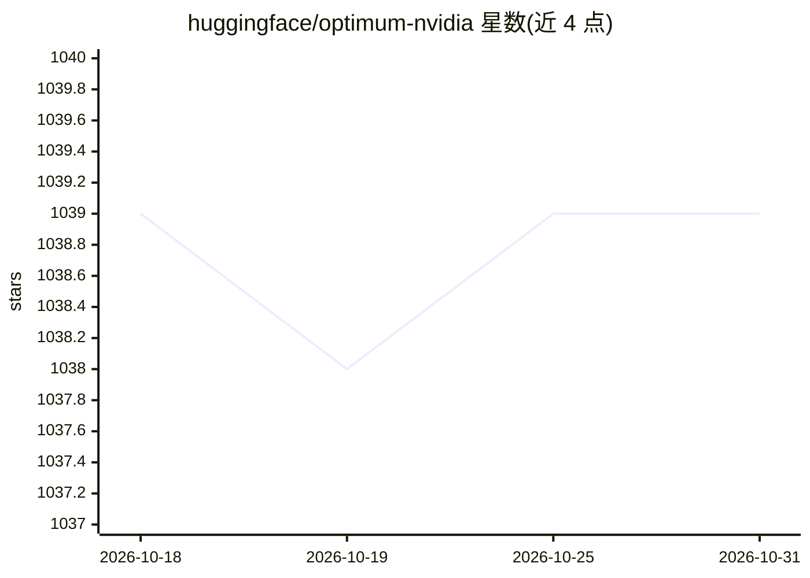

# huggingface/optimum-nvidia

⭐ 1,039 · Python · Apache-2.0 · 推送 2026-09-24 · [GitHub](https://github.com/huggingface/optimum-nvidia) · 组织维护

**面向 NVIDIA GPU 的 Hugging Face transformers 推理加速库**

Hugging Face 维护的推理加速库：通过替换 transformers 代码中的单行导入（pipelines 或 AutoModelForCausalLM），在 NVIDIA GPU 上运行 LLaMA 2 等文本生成模型，支持 FP8 量化。README 称在 4090、L40S、H100 上测试，兼容 Ampere/Hopper/Ada-Lovelace 架构（FP8 仅限 Hopper 与 Ada-Lovelace）。Pip 安装仅在 Ubuntu 上验证过，另有 Docker 镜像与源码编译（含 TensorRT-LLM）途径。当前仅加速 LLaMAForCausalLM 文本生成，仅支持 Linux。面向已有 transformers 代码的开发者。

## 筛选速览

| 维度 | 判定 | 备注 |
|---|---|---|
| AI 角色 | `ai-ecosystem` | LLM/agent 周边工具 |
| 许可风险 | `permissive` | Apache-2.0 |
| 部署形态 | `self-host` | docker 或自建部署 |
| 模型依赖 | — | README 未给出锁定关系 |
| 硬件要求 | — | 无带数字的原话,不猜 |
| 安装摩擦 | `low` | 无编译、无系统依赖或容器化 |
| 成熟度 | `idea` | |

## 能力要点

- 单行导入替换即可将 transformers pipeline/generate 切换到 NVIDIA 加速路径
- 支持 FP8 量化（Hopper/Ada-Lovelace 架构）
- 提供 Docker 镜像与含 TensorRT-LLM 的源码编译流程
- 在 4090/L40S/H100 上测试，兼容 Ampere/Hopper/Ada-Lovelace

## 适用场景

- 已有 transformers 代码希望在 NVIDIA GPU 上加速 LLaMA 2 文本生成
- 使用 FP8 量化在 Hopper/Ada-Lovelace GPU 上运行推理
- 通过 Docker 镜像快速试用该加速方案

## 场景标签

`推理引擎` `模型量化` · 领域:训练与推理

## 证据(README 行号)

> L10: Optimum-NVIDIA delivers the best inference performance on the NVIDIA platform through Hugging Face. Run LLaMA 2 at 
> L46: Hugging Face pipelines provide a simple yet powerful abstraction to quickly set up inference. If you already have a
> L62: + from optimum.nvidia import AutoModelForCausalLM

## 星数曲线

2026-10-18 1,039 → 2026-10-31 1,039（+0）

---
*卡片 v1 · prompt 1.4 · 生成 2026-10-21 · 置信度 high · 依据 README sha `7d1ca6c32d11` · [字段定义](../../DATASET.md)*
