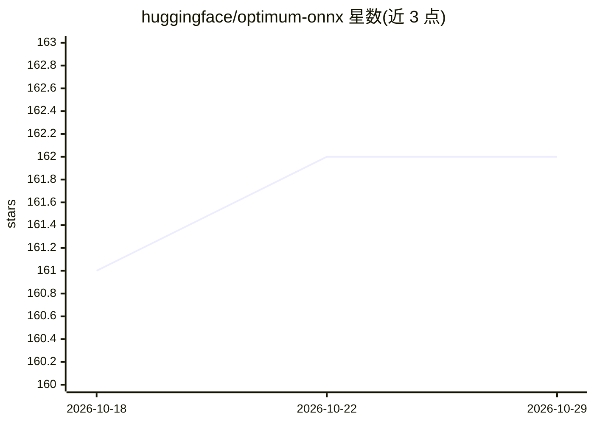

# huggingface/optimum-onnx

⭐ 162 · Python · Apache-2.0 · 推送 2026-10-06 · [GitHub](https://github.com/huggingface/optimum-onnx) · [官网](https://huggingface.co/docs/optimum-onnx/en/quickstart) · 组织维护

**将 Hugging Face 模型导出为 ONNX 并用 ONNX Runtime 推理的扩展库**

Hugging Face Optimum 的 ONNX 扩展：支持将 Transformers、Diffusers、Timm 和 Sentence Transformers 模型导出为 ONNX 格式，并可进行图优化与量化。提供 optimum-cli 命令行导出工具和 ORTModelForXXX 等 Python 类，在 ONNX Runtime 后端上运行导出后的模型。通过 pip 安装，GPU 使用需满足 CUDA 与 cuDNN 依赖并安装 onnxruntime-gpu 扩展，且需避免与 CPU 版 onnxruntime 共存冲突。面向使用 Hugging Face 生态的开发者。

## 筛选速览

| 维度 | 判定 | 备注 |
|---|---|---|
| AI 角色 | `ai-ecosystem` | LLM/agent 周边工具 |
| 许可风险 | `permissive` | Apache-2.0 |
| 部署形态 | `library` | 以包/库形式分发 |
| 模型依赖 | — | README 未给出锁定关系 |
| 硬件要求 | — | 无带数字的原话,不猜 |
| 安装摩擦 | `medium` | 含编译或系统依赖之一 |
| 成熟度 | — | 结构信号不足 |

## 能力要点

- 支持 Transformers/Diffusers/Timm/Sentence Transformers 模型导出 ONNX
- optimum-cli 命令行导出与优化、量化
- ORTModelForXXX Python 类以 ONNX Runtime 为后端运行推理

## 适用场景

- 把 Hugging Face 模型转为 ONNX 格式部署
- 对模型做图优化和量化以适配 ONNX Runtime
- 在 Python 代码中直接用 ONNX Runtime 后端运行导出模型

## 场景标签

`推理引擎` `模型量化` · 领域:训练与推理

## 证据(README 行号)

> L25: It is possible to export 🤗 Transformers, Diffusers, Timm and Sentence Transformers models to the ONNX format and pe
> L36: Once the model is exported to the ONNX format, we provide Python classes enabling you to run the exported ONNX mode

## 星数曲线

2026-10-18 161 → 2026-10-29 162（+1）

---
*卡片 v1 · prompt 1.4 · 生成 2026-10-22 · 置信度 high · 依据 README sha `efdef6ddb656` · [字段定义](../../DATASET.md)*
