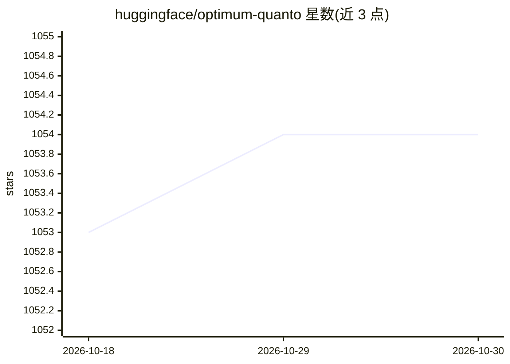

# huggingface/optimum-quanto

⭐ 1,054 · Python · Apache-2.0 · 推送 2026-10-26 · [GitHub](https://github.com/huggingface/optimum-quanto) · 组织维护

**PyTorch 模型量化库：将 float 模型转为低比特量化模型**

Optimum 的 PyTorch 量化后端，面向需要压缩模型体积与显存占用的开发者。支持 int2/int4/int8/float8 权重与 int8/float8 激活量化，全部功能可在 eager 模式使用，量化模型可放置于任意设备（含 CUDA 与 MPS）；提供从量化、校准、量化感知训练到冻结、序列化（pickle/safetensors）与重载的完整工作流，自动插入量化模块（Linear/Conv2d/LayerNorm）。项目处于维护模式，仅接受小修复与文档改进。

## 筛选速览

| 维度 | 判定 | 备注 |
|---|---|---|
| AI 角色 | `ai-ecosystem` | LLM/agent 周边工具 |
| 许可风险 | `permissive` | Apache-2.0 |
| 部署形态 | `library` | 以包/库形式分发 |
| 模型依赖 | — | README 未给出锁定关系 |
| 硬件要求 | — | 无带数字的原话,不猜 |
| 安装摩擦 | `medium` | 含编译或系统依赖之一 |
| 成熟度 | — | 结构信号不足 |

## 能力要点

- 支持 int2/int4/int8/float8 权重与 int8/float8 激活量化
- eager 模式全功能可用，兼容不可 trace 的模型
- 提供 HuggingFace/diffusers 模型的一键量化保存与重载辅助类
- CUDA 上加速矩阵乘法（int8-int8、fp16-int4、bf16-int8 等）

## 适用场景

- 压缩 LLM/扩散模型的权重与显存占用
- 对 PyTorch 模型做训练后量化或量化感知训练
- 将量化后的 HuggingFace 模型序列化为 safetensors 并重载

## 场景标签

`模型量化` · 领域:训练与推理

## 证据(README 行号)

> L5: 🤗 Optimum Quanto is a pytorch quantization backend for optimum.
> L14: - provides a seamless workflow from a float model to a dynamic to a static quantized model,

## 星数曲线

2026-10-18 1,053 → 2026-10-30 1,054（+1）

---
*卡片 v1 · prompt 1.4 · 生成 2026-10-21 · 置信度 high · 依据 README sha `4da677a2dec6` · [字段定义](../../DATASET.md)*
