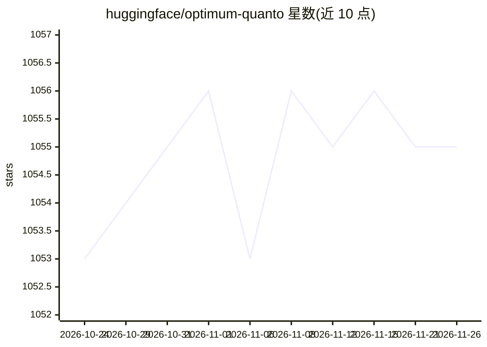

# huggingface/optimum-quanto

⭐ 1,055 · Python · Apache-2.0 · 推送 2026-11-24 · [GitHub](https://github.com/huggingface/optimum-quanto) · 组织维护

**为 PyTorch/Hugging Face 模型提供量化后端的 Python 库**

Optimum 的 PyTorch 量化后端：支持 int2/int4/int8/float8 权重与 int8/float8 激活，自动插入量化/反量化 stub 与量化模块，提供从 float 模型到动态/静态量化模型的流程，含校准与量化感知训练步骤。为 transformers 因果语言模型与 diffusers 管线提供 helper 类，序列化兼容 weight_only 与 safetensors。所有功能可在 eager 模式下使用，量化模型可放置于任意设备。项目处于维护模式，仅接受小修复与文档类 PR。

## 筛选速览

| 维度 | 判定 | 备注 |
|---|---|---|
| AI 角色 | `ai-native` | 本体是模型或模型工具 |
| 许可风险 | `permissive` | Apache-2.0 |
| 部署形态 | `library` | 以包/库形式分发 |
| 模型依赖 | — | README 未给出锁定关系 |
| 硬件要求 | — | 无带数字的原话,不猜 |
| 安装摩擦 | `medium` | 含编译或系统依赖之一 |
| 成熟度 | — | 结构信号不足 |

## 能力要点

- 支持 int2/int4/int8 与 float8 权重、int8/float8 激活
- 为 LLM 与 diffusers 管线提供 quantize/save/reload helper 类
- 支持校准与量化感知训练（QAT）工作流
- 序列化兼容 pytorch weight_only 与 safetensors

## 适用场景

- 将 Hugging Face LLM 量化为 int4/int8 以降低显存占用
- 量化 diffusers 管线中的 transformer 子模型
- 对 vanilla PyTorch 模型执行校准与量化感知训练

## 场景标签

`模型量化` · 领域:训练与推理

## 证据(README 行号)

> L5: 🤗 Optimum Quanto is a pytorch quantization backend for optimum.
> L3: > This project is currently in maintenance mode. We accept pull requests only for minor bug fixes, documentation imp

## 星数曲线

2026-10-24 1,053 → 2026-11-26 1,055（+2）

---
*卡片 v1 · prompt 1.4 · 生成 2026-11-24 · 置信度 high · 依据 README sha `238eedeea5f2` · [字段定义](../../DATASET.md)*
