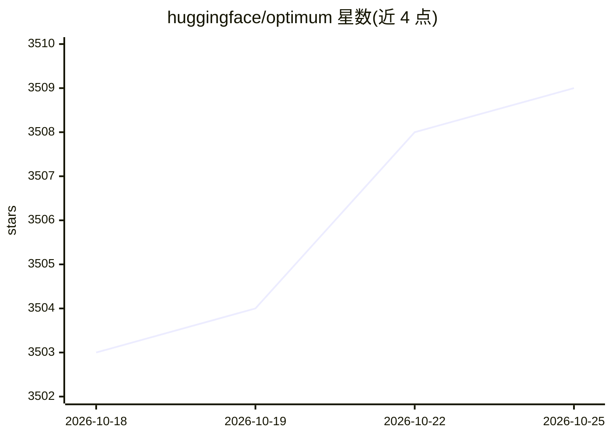

# huggingface/optimum

⭐ 3,509 · Python · Apache-2.0 · 推送 2026-10-19 · [GitHub](https://github.com/huggingface/optimum) · [官网](https://huggingface.co/docs/optimum/main/) · 组织维护

**加速 Transformers 等模型推理与训练的硬件优化工具库**

Hugging Face 维护的 Transformers、Diffusers、TIMM 与 Sentence-Transformers 扩展库：提供模型导出、图优化、量化与加速训练工具，覆盖 ONNX Runtime、OpenVINO、ExecuTorch、Intel Gaudi、AWS Neuron、TensorRT-LLM 等多种加速器与运行时。支持 pip 按加速器类型安装 extras，可编程或用 optimum-cli 命令行完成导出与优化。面向需要在特定硬件上高效训练和推理的模型开发者。

## 筛选速览

| 维度 | 判定 | 备注 |
|---|---|---|
| AI 角色 | `ai-ecosystem` | LLM/agent 周边工具 |
| 许可风险 | `permissive` | Apache-2.0 |
| 部署形态 | `self-host` | docker 或自建部署 |
| 模型依赖 | — | README 未给出锁定关系 |
| 硬件要求 | — | 无带数字的原话,不猜 |
| 安装摩擦 | `low` | 无编译、无系统依赖或容器化 |
| 成熟度 | — | 结构信号不足 |

## 能力要点

- 模型导出到 ONNX / OpenVINO / ExecuTorch 并执行图优化与量化
- 围绕 Transformers Trainer 的封装支持 Gaudi、Trainium 等硬件加速训练
- Quanto 量化后端，可通过 Python API 或 optimum-cli 使用
- 按加速器类型的 pip extras 安装（onnxruntime/openvino/habana/neuronx 等）

## 适用场景

- 把 Transformers 模型导出并量化后部署到目标推理引擎
- 在 Intel Gaudi 或 AWS Trainium 上加速模型训练
- 将模型导出到边缘设备用 ExecuTorch 运行

## 场景标签

`推理引擎` `模型量化` `微调` · 领域:训练与推理

## 证据(README 行号)

> L9: Optimum is an extension of Transformers 🤖 Diffusers 🧨 TIMM 🖼️ and Sentence-Transformers 🤗, providing a set of optimi
> L49: Optimum provides multiple tools to export and run optimized models on various ecosystems:

## 星数曲线

2026-10-18 3,503 → 2026-10-25 3,509（+6）

---
*卡片 v1 · prompt 1.4 · 生成 2026-10-20 · 置信度 mid · 依据 README sha `3ada47e022fc` · [字段定义](../../DATASET.md)*
