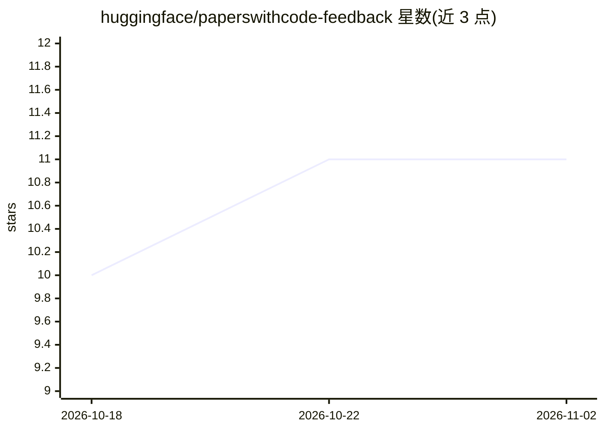

# huggingface/paperswithcode-feedback

⭐ 11 · MIT · 推送 2026-05-18 · [GitHub](https://github.com/huggingface/paperswithcode-feedback) · 组织维护

**收集对 Papers with Code 网站反馈的社区仓库**

Hugging Face 维护的反馈收集仓库，供用户以 issue 或清单形式提出对 paperswithcode 网站的意见和问题。README 仅两行，说明用途为让人们对 paperswithcode 列出反馈，未描述具体流程、数据或工具。paperswithcode 本身是论文与代码实现的聚合网站，本仓库不直接提供论文数据或检索功能。

## 筛选速览

| 维度 | 判定 | 备注 |
|---|---|---|
| AI 角色 | `ai-knowledge` | 知识聚合/清单类 |
| 许可风险 | `permissive` | MIT |
| 部署形态 | `None` |  |
| 模型依赖 | — | README 未给出锁定关系 |
| 硬件要求 | — | 无带数字的原话,不猜 |
| 安装摩擦 | `low` | 无编译、无系统依赖或容器化 |
| 成熟度 | — | 结构信号不足 |

## 能力要点

- 供社区提交对 paperswithcode 的反馈
- 由 Hugging Face 组织维护

## 适用场景

- 向 paperswithcode 提交问题或改进建议
- 查看他人反馈了解站点已知问题

## 场景标签

 · 领域:科研工具/社区协作

## 证据(README 行号)

> L3: A repository to let people list feedback on paperswithcode.

## 星数曲线

2026-10-18 10 → 2026-11-02 11（+1）

---
*卡片 v1 · prompt 1.4 · 生成 2026-11-02 · 置信度 low · 依据 README sha `9f7c4467a788` · [字段定义](../../DATASET.md)*
