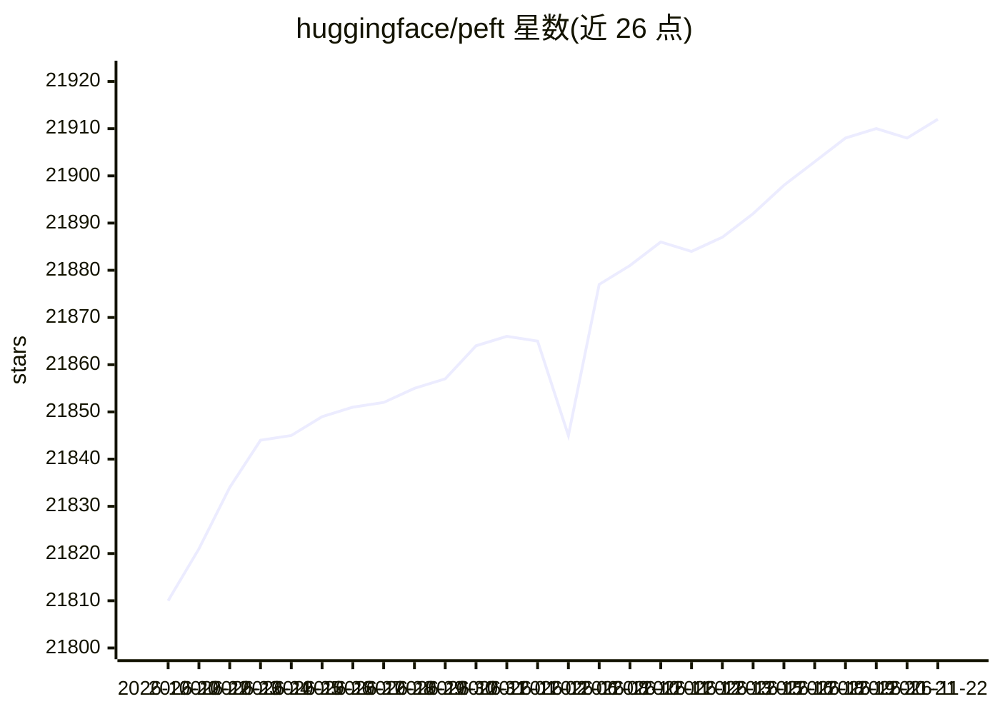

# huggingface/peft

⭐ 21,912 · Python · Apache-2.0 · 推送 2026-11-20 · [GitHub](https://github.com/huggingface/peft) · [官网](https://huggingface.co/docs/peft) · 组织维护

**给开发者用少量参数微调大型预训练模型的库**

PEFT 是 Hugging Face 的参数高效微调库：通过只微调少量（新增）模型参数来适配大模型到下游任务，降低计算与存储成本。库内实现 LoRA 等多种 PEFT 方法，检查点体积可缩小至 MB 级。与 Transformers（模型加载/adapter 管理）、Diffusers（扩散模型 adapter）、Accelerate（分布式训练）、TRL（RLHF/DPO）集成。以 Python 包形式通过 pip 安装，README 给出训练与推理的快速上手代码，并提供 LoRA 内存占用与精度数据表。

## 筛选速览

| 维度 | 判定 | 备注 |
|---|---|---|
| AI 角色 | `ai-native` | 本体是模型或模型工具 |
| 许可风险 | `permissive` | Apache-2.0 |
| 部署形态 | `library` | 以包/库形式分发 |
| 模型依赖 | — | README 未给出锁定关系 |
| 硬件要求 | — | 无带数字的原话,不猜 |
| 安装摩擦 | `low` | 无编译、无系统依赖或容器化 |
| 成熟度 | — | 结构信号不足 |

## 动量与使用信号

- 维护:`active` — 距上次 push 2.0 天,年发版 8,371 位贡献者
- 涨星:近 1 天 **+5**(自 20261016 起算)
- 安装:pypi 包 `peft` 月下载 8,262,388

## 能力要点

- 实现多种参数高效微调方法，LoRA 训练可只更新约 0.12% 的参数
- 与 Transformers、Diffusers、Accelerate、TRL 集成
- 支持与量化方法组合（QLoRA）进一步降低显存需求
- 提供 consumer hardware 上的训练内存需求对照表

## 适用场景

- 在消费级 GPU 上微调 LLM 用于下游任务
- 为 Stable Diffusion 训练 LoRA/DreamBooth adapter
- 多任务场景下保存多个小体积 adapter 并切换加载
- 配合 TRL 做 RLHF/DPO 训练

## 场景标签

`微调` `图像生成` `强化学习` · 领域:内容生成

## 证据(README 行号)

> L3:  State-of-the-art Parameter-Efficient Fine-Tuning (PEFT) methods
> L5: Fine-tuning large pretrained models is often prohibitively costly due to their scale. Parameter-Efficient Fine-Tunin
> L7: PEFT is integrated with Transformers for easy model training and inference, Diffusers for conveniently managing diff

## 星数曲线

2026-10-20 21,810 → 2026-11-22 21,912（+102）

---
*卡片 v1 · prompt 1.4 · 生成 2026-11-22 · 置信度 high · 依据 README sha `8aafd6ae8882` · [字段定义](../../DATASET.md)*
