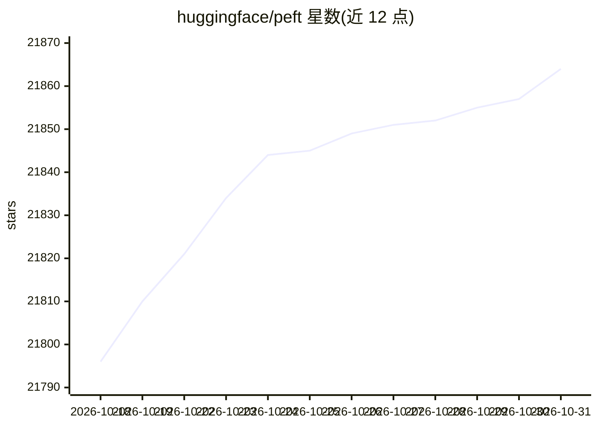

# huggingface/peft

⭐ 21,864 · Python · Apache-2.0 · 推送 2026-10-30 · [GitHub](https://github.com/huggingface/peft) · [官网](https://huggingface.co/docs/peft) · 组织维护

**大模型参数高效微调库：小参数量适配下游任务**

Hugging Face 的参数高效微调（PEFT）库，通过仅微调少量（额外）参数实现大模型向下游任务的适配，降低计算与存储开销，检查点仅数 MB 量级。与 Transformers 集成用于训练推理、Diffusers 管理适配器、Accelerate 支持分布式训练推理，并可与量化（QLoRA）、TRL（RLHF/DPO）组合使用。通过 pip 安装，README 提供 LoRA 训练与推理的代码示例及各方法的概念指南与 API 参考。

## 筛选速览

| 维度 | 判定 | 备注 |
|---|---|---|
| AI 角色 | `ai-native` | 本体是模型或模型工具 |
| 许可风险 | `permissive` | Apache-2.0 |
| 部署形态 | `library` | 以包/库形式分发 |
| 模型依赖 | — | README 未给出锁定关系 |
| 硬件要求 | — | 无带数字的原话,不猜 |
| 安装摩擦 | `low` | 无编译、无系统依赖或容器化 |
| 成熟度 | — | 结构信号不足 |

## 动量与使用信号

- 维护:`active` — 距上次 push 2.0 天,年发版 8,371 位贡献者
- 涨星:近 1 天 **+5**(自 20261016 起算)
- 安装:pypi 包 `peft` 月下载 8,262,388

## 能力要点

- 仅微调少量参数即可适配大模型（示例中仅训练 0.19% 参数）
- 与 Transformers/Diffusers/Accelerate 集成，支持适配器加载与切换
- 支持 LoRA 等多种 PEFT 方法，可与量化、TRL/RLHF 组合
- 提供 Stable Diffusion LoRA DreamBooth 训练脚本与示例 Space

## 适用场景

- 在消费级 GPU 上微调 LLM 而不 OOM
- 为 Stable Diffusion 训练 LoRA 适配器
- 用 RLHF/DPO 微调 LLM 时降低显存与存储开销
- 为多个下游任务保存轻量适配器而非完整模型

## 场景标签

`微调` · 领域:训练与推理

## 证据(README 行号)

> L3:  State-of-the-art Parameter-Efficient Fine-Tuning (PEFT) methods
> L5: Fine-tuning large pretrained models is often prohibitively costly due to their scale. Parameter-Efficient Fine-Tunin
> L7: PEFT is integrated with Transformers for easy model training and inference, Diffusers for conveniently managing diff

## 星数曲线

2026-10-18 21,796 → 2026-10-31 21,864（+68）

---
*卡片 v1 · prompt 1.4 · 生成 2026-10-18 · 置信度 high · 依据 README sha `9b9ca242831c` · [字段定义](../../DATASET.md)*
