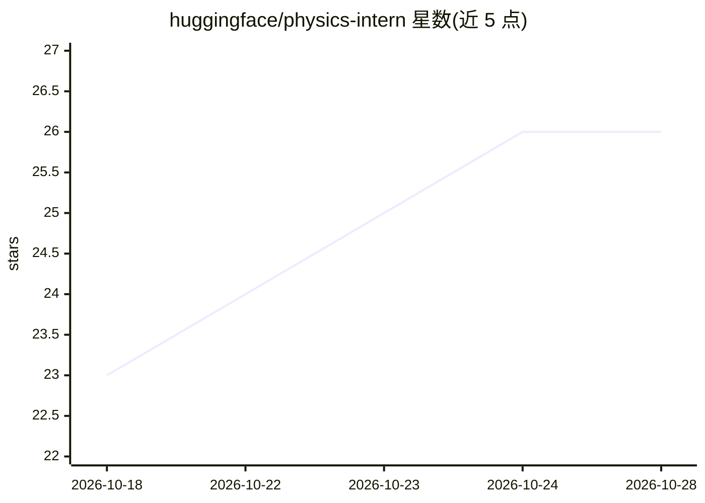

# huggingface/physics-intern

⭐ 26 · Shell · 推送 2026-07-01 · [GitHub](https://github.com/huggingface/physics-intern) · 组织维护

**驱动 AI 编码代理执行理论物理研究的方法论包**

面向使用 Claude Code、Pi、OpenAI Codex CLI、OpenCode 四种编码代理宿主的方法论包：在 problem.md 写入研究问题，运行引导脚本渲染工作区（主代理提示词、七个子代理角色、八项工作流技能），代理随后自主完成文献综述、计划起草、向新上下文子代理分发解析推导与数值计算、对抗性评审并综合出 answer.md。文件为持久状态、会话可随时清空，宿主提供联网搜索与 Python 执行，本包自身无需 API key，无第三方依赖。限制：无 MCP 集成、无工作区升级路径。

## 筛选速览

| 维度 | 判定 | 备注 |
|---|---|---|
| AI 角色 | `ai-ecosystem` | LLM/agent 周边工具 |
| 许可风险 | `none` | — |
| 部署形态 | `None` |  |
| 模型依赖 | locked-api |  |
| 硬件要求 | — | 无带数字的原话,不猜 |
| 安装摩擦 | `low` | 无编译、无系统依赖或容器化 |
| 成熟度 | — | 结构信号不足 |

## 能力要点

- 支持四种编码代理宿主（Claude Code/Pi/Codex CLI/OpenCode），同一方法论跨宿主运行
- 主代理仅做协调，推导/计算/评审均派发至新上下文子代理，主张需≥2 独立验证才确立
- 8 个斜杠命令技能（/survey、/derive、/compute、/review、/finalize、/autoresearch 等）
- 文件即持久状态，可随时清空上下文从 research_log.md 与 plan.md 续跑

## 适用场景

- 我把理论物理或数学研究问题交给编码代理，按结构化流程产出带验证的答案
- 跨 Claude Code/Codex/OpenCode 等宿主复用同一套代理研究方法论
- 对代理产出的推导与计算做独立上下文的对抗性评审

## 场景标签

`科研工具` `提示工程` · 领域:Agent 开发

## 证据(README 行号)

> L3: A methodology package for using AI coding agents (Claude Code, Pi, OpenAI Codex CLI, OpenCode) to conduct theoretica
> L5: PhysicsIntern is **host-agnostic**: the same methodology runs on four coding-agent hosts, with the host chosen at wo
> L115: - Creates `CLAUDE.md` (Claude) or `AGENTS.md` (Pi, Codex, OpenCode) — the main-agent prompt encoding the entire re
> L116: - Renders the seven sub-agent role prompts and eight workflow skills into the host's expected layout.

## 星数曲线

2026-10-18 23 → 2026-10-28 26（+3）

---
*卡片 v1 · prompt 1.4 · 生成 2026-10-26 · 置信度 high · 依据 README sha `3baf5bd08981` · [字段定义](../../DATASET.md)*
