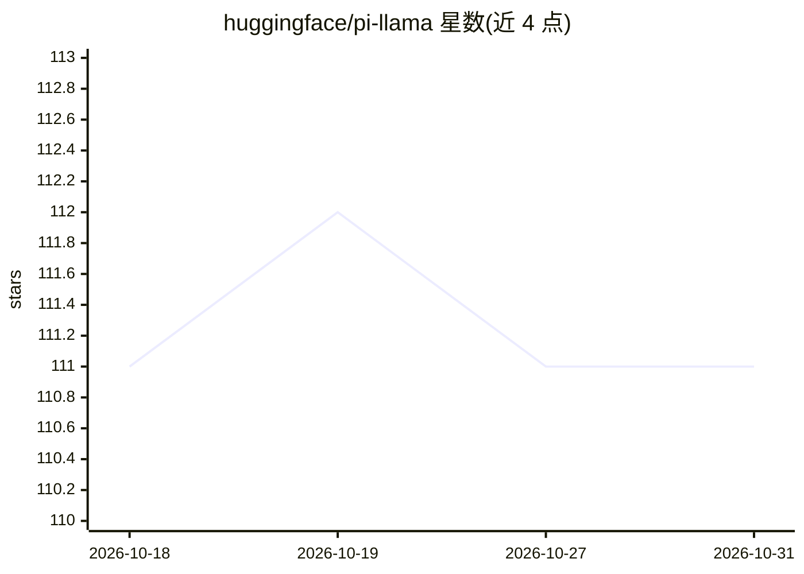

# huggingface/pi-llama

⭐ 111 · TypeScript · 推送 2026-10-30 · [GitHub](https://github.com/huggingface/pi-llama) · 组织维护

**Pi coding agent 扩展：自动发现 llama.cpp 服务模型并注册为 provider**

Hugging Face 维护的 Pi 编码代理扩展：连接正在运行的 llama.cpp 服务器，自动发现可用模型与上下文窗口，并在 pi 中注册为 llama-cpp provider。通过 pi install 命令从 GitHub 克隆安装到 ~/.pi/agent/packages/ 并自动加载，也支持开发模式用 -e 参数临时加载。通过 LLAMA_BASE_URL 与 LLAMA_API_KEY 环境变量配置连接，默认地址 http://localhost:8080/v1。

## 筛选速览

| 维度 | 判定 | 备注 |
|---|---|---|
| AI 角色 | `ai-ecosystem` | LLM/agent 周边工具 |
| 许可风险 | `none` | — |
| 部署形态 | `None` |  |
| 模型依赖 | — | README 未给出锁定关系 |
| 硬件要求 | — | 无带数字的原话,不猜 |
| 安装摩擦 | `low` | 无编译、无系统依赖或容器化 |
| 成熟度 | — | 结构信号不足 |

## 能力要点

- 自动发现运行中 llama.cpp 服务器的模型与上下文窗口
- 将模型注册为 pi 中的 llama-cpp provider
- 支持 LLAMA_BASE_URL / LLAMA_API_KEY 环境变量配置

## 适用场景

- Pi 用户在编码代理中调用本地 llama.cpp 服务器上的模型
- 通过本地推理服务为编码任务提供模型后端

## 场景标签

 · 领域:开发者工具/AI 基础设施

## 证据(README 行号)

> L3: llama.cpp Pi extension. Auto-discovers models from a running llama.cpp server and
> L4: registers them as the `llama-cpp` provider in pi.

## 星数曲线

2026-10-18 111 → 2026-10-31 111（+0）

---
*卡片 v1 · prompt 1.4 · 生成 2026-10-23 · 置信度 high · 依据 README sha `5fb9097a0d0d` · [字段定义](../../DATASET.md)*
