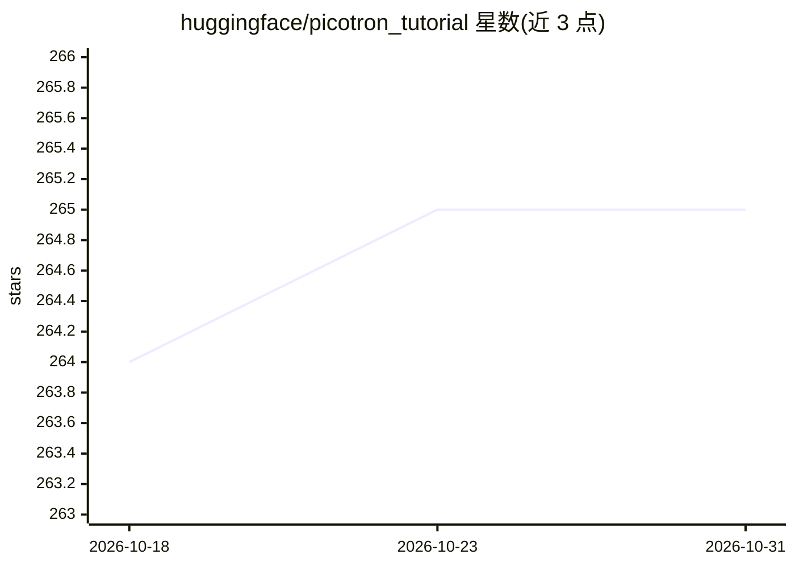

# huggingface/picotron_tutorial

⭐ 265 · Python · 推送 2025-11-24 · [GitHub](https://github.com/huggingface/picotron_tutorial) · 组织维护

**从零构建 Picotron 分布式训练框架的分步教程**

Hugging Face 出品的逐步教程仓库，配套视频系列讲解如何从零实现分布式训练框架 Picotron：涵盖模型与进程组管理、数据加载器、张量并行（Tensor Parallel）、朴素与分桶数据并行（Data Parallel）及分布式代码调试。仓库提供可安装运行的代码（pip install -e .），并含 Llama 1B 模型在 4096000 token 上的收敛性检验，用 torchrun 启动训练并用 wandb 记录。面向希望理解分布式训练实现细节的开发者与学习者。

## 筛选速览

| 维度 | 判定 | 备注 |
|---|---|---|
| AI 角色 | `ai-knowledge` | 知识聚合/清单类 |
| 许可风险 | `none` | — |
| 部署形态 | `library` | 以包/库形式分发 |
| 模型依赖 | — | README 未给出锁定关系 |
| 硬件要求 | — | 无带数字的原话,不猜 |
| 安装摩擦 | `low` | 无编译、无系统依赖或容器化 |
| 成熟度 | — | 结构信号不足 |

## 能力要点

- 分步实现进程组管理、Dataloader、张量并行、数据并行
- 配套 YouTube 视频系列（Part 1-3 及调试专题）
- 提供 Llama 1B / TinyLlama 的收敛性检验脚本（torchrun 启动）

## 适用场景

- 学习分布式训练框架（张量并行/数据并行）的从零实现
- 跟随视频与代码逐步搭建并验证自己的训练框架
- 排查分布式训练代码问题（配套调试视频）

## 场景标签

`教程课程` · 领域:学习与行业

## 证据(README 行号)

> L3: A step by step tutorial on how to build Picotron distributed training framework form scratch 🔥
> L24: - Convergence testing on a Llama 1B on 4096000 tokens to see if loss match.

## 星数曲线

2026-10-18 264 → 2026-10-31 265（+1）

---
*卡片 v1 · prompt 1.4 · 生成 2026-10-22 · 置信度 high · 依据 README sha `077a77019000` · [字段定义](../../DATASET.md)*
