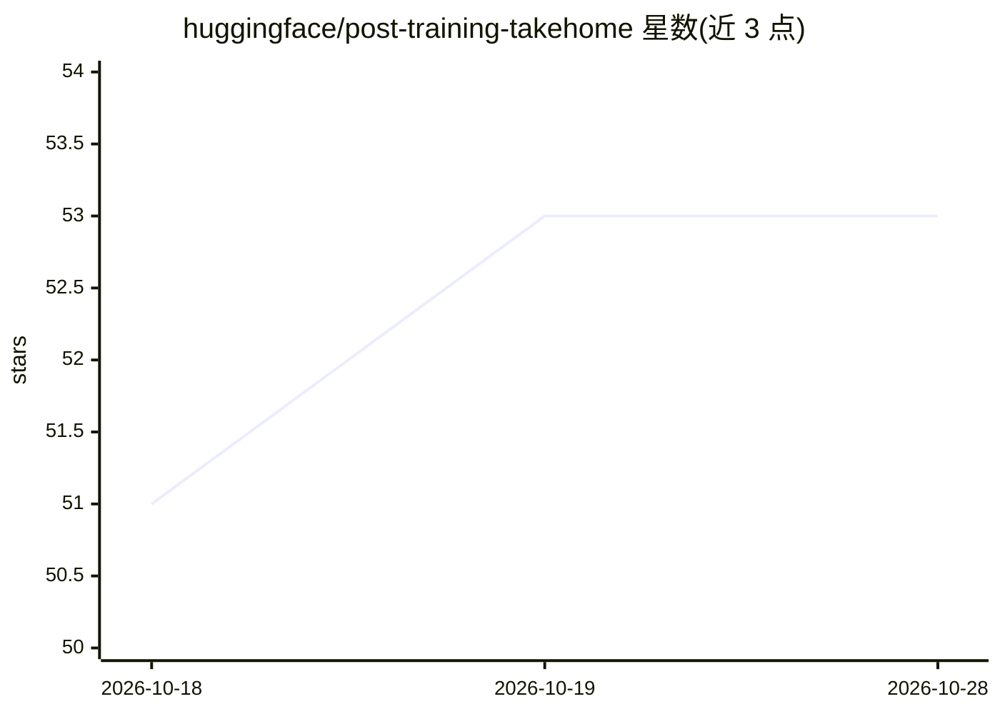

# huggingface/post-training-takehome

⭐ 53 · 推送 2026-04-23 · [GitHub](https://github.com/huggingface/post-training-takehome) · 组织维护

**Hugging Face 后训练团队实习的家庭作业挑战题**

Hugging Face 后训练团队公开的实习录用 take-home 挑战：要求在约 3 小时内复现 Best-of-N 加权采样基线——从 MATH-500 筛选 20 道题，用 Qwen2.5-1.5B-Instruct 生成贪心与 N=16 采样解，用 Skywork 过程奖励模型（取末步预测）打分，按同答案分组加权选出最优解，比较准确率，生成数据集上传 Hub 并撰写分析图与数据集卡。模型规模按 T4 GPU 设计，评分侧重代码可读性与过程解释。

## 筛选速览

| 维度 | 判定 | 备注 |
|---|---|---|
| AI 角色 | `ai-knowledge` | 知识聚合/清单类 |
| 许可风险 | `none` | — |
| 部署形态 | `None` |  |
| 模型依赖 | — | README 未给出锁定关系 |
| 硬件要求 | — | 无带数字的原话,不猜 |
| 安装摩擦 | `low` | 无编译、无系统依赖或容器化 |
| 成熟度 | — | 结构信号不足 |

## 能力要点

- 复现 Best-of-N 加权选择基线（含贪心对照）
- 使用 Qwen2.5-1.5B-Instruct 与 Skywork PRM 两个 1.5B 模型
- 模型规模可在 T4 GPU 上运行，建议用时约 3 小时
- 允许借助 LLM 协作但需标注 LLM 共同编写的部分

## 适用场景

- 应聘者完成 HF 后训练实习考核
- 练习奖励模型驱动的 Best-of-N 采样实现
- 了解 HF 团队对 ML 工程能力的评估标准

## 场景标签

`教程课程` · 领域:学习与行业

## 证据(README 行号)

> L1: # Hugging Face's Post-Training Internship Take-Home
> L9: In this exercise, you will be replicating a baseline method from this approach: **Best-of-N sampling with _weighted_

## 星数曲线

2026-10-18 51 → 2026-10-28 53（+2）

---
*卡片 v1 · prompt 1.4 · 生成 2026-10-24 · 置信度 high · 依据 README sha `9cd71ec81bb9` · [字段定义](../../DATASET.md)*
