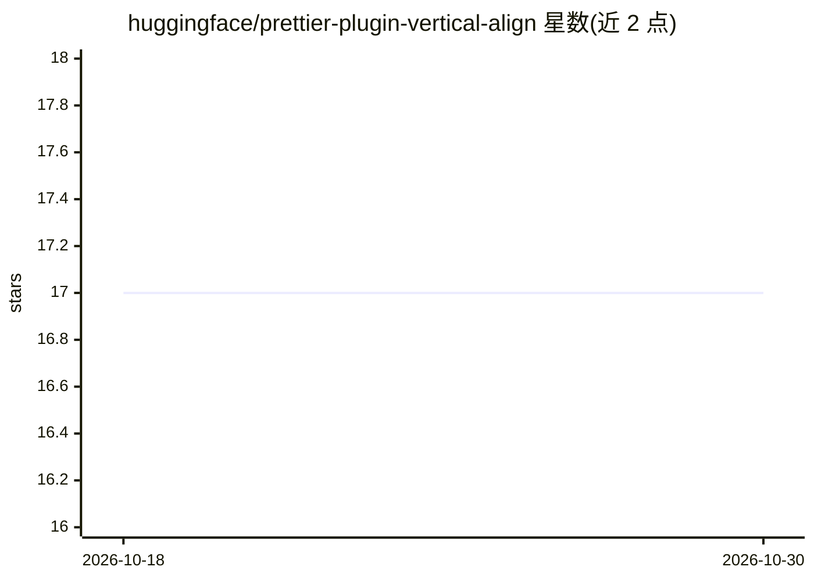

# huggingface/prettier-plugin-vertical-align

⭐ 17 · TypeScript · 推送 2026-09-24 · [GitHub](https://github.com/huggingface/prettier-plugin-vertical-align) · 组织维护

**给 JS/TS 开发者：将对象属性与接口成员的冒号垂直对齐的 Prettier 插件**

Hugging Face 维护的 Prettier 插件，用于 JavaScript/TypeScript 代码格式化时对齐对象属性与接口成员：仅加宽键与值之间的冒号间距实现垂直对齐，其余格式化仍由 prettier 输出；格式化幂等，重复运行不改变已格式化文件。通过在 .prettiurrc 中添加 plugins 字段安装，提供 alignInGroups 配置按空行或多行值分组对齐，分组规则设计上避免格式在两种状态间振荡。

## 筛选速览

| 维度 | 判定 | 备注 |
|---|---|---|
| AI 角色 | `ai-ecosystem` | LLM/agent 周边工具 |
| 许可风险 | `none` | — |
| 部署形态 | `None` |  |
| 模型依赖 | — | README 未给出锁定关系 |
| 硬件要求 | — | 无带数字的原话,不猜 |
| 安装摩擦 | `low` | 无编译、无系统依赖或容器化 |
| 成熟度 | — | 结构信号不足 |

## 能力要点

- 对齐对象属性与接口成员的冒号
- 格式化幂等，重复运行不再改动
- alignInGroups 配置支持按空行/多行值分组对齐

## 适用场景

- 统一代码库中对象字面量的对齐风格
- 对接口成员做垂直对齐以提升可读性

## 场景标签

 · 领域:前端/开发工具

## 证据(README 行号)

> L1: # prettier-plugin-vertical-align
> L3: Align object properties and interface members vertically for JS/TS code.

## 星数曲线

2026-10-18 17 → 2026-10-30 17（+0）

---
*卡片 v1 · prompt 1.4 · 生成 2026-10-29 · 置信度 mid · 依据 README sha `9557a90e75c0` · [字段定义](../../DATASET.md)*
