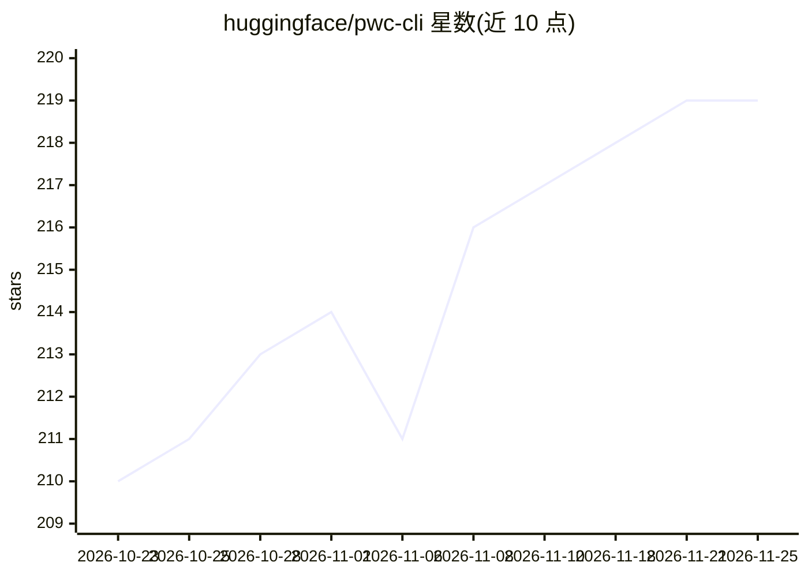

# huggingface/pwc-cli

⭐ 219 · Python · 推送 2026-11-23 · [GitHub](https://github.com/huggingface/pwc-cli) · 组织维护

**给开发者与 agent 提供 Papers with Code 论文目录的 CLI/MCP 访问**

huggingface/pwc-cli 提供三件形态：交互/脚本化的 pwc CLI、供 coding agent 加载的 Skill、以及只读 MCP 服务器（含托管实例）。命令覆盖论文搜索、元数据与 Markdown 读取、趋势与相关工作发现、lineage 追溯、任务/方法/会议/机构/框架/基准浏览及排行榜筛选；编辑论文需登录且限单篇授权一小时。公共读取匿名无 token，输出支持 JSON/TSV/Markdown 并有稳定退出码，可通过 PWC_API_URL 指向兼容 v1 API。

## 筛选速览

| 维度 | 判定 | 备注 |
|---|---|---|
| AI 角色 | `ai-knowledge` | 知识聚合/清单类 |
| 许可风险 | `none` | — |
| 部署形态 | `None` |  |
| 模型依赖 | — | README 未给出锁定关系 |
| 硬件要求 | — | 无带数字的原话,不猜 |
| 安装摩擦 | `low` | 无编译、无系统依赖或容器化 |
| 成熟度 | — | 结构信号不足 |

## 能力要点

- CLI、Agent Skill 与 MCP 服务器三形态共用同一命令集
- 公共读取匿名免 token，托管 MCP 实例无需 API key
- 支持语义搜索、官方实现过滤、lineage 与 SOTA 基准查询
- JSON 输出含 schema_version，退出码与批处理脚本友好

## 适用场景

- 在终端里搜索并阅读 Papers with Code 目录中的论文与基准
- 让 coding agent 通过 Skill/MCP 检索相关论文与 SOTA 方法
- 批量脚本化导出论文元数据与评测表

## 场景标签

`科研工具` `模型评测` `语义搜索` `编码 Agent` · 领域:编码与开发

## 证据(README 行号)

> L1: # pwc CLI, Skill, and MCP server
> L3: A fast command-line client for exploring and editing the
> L51: - search papers
> L290: Public catalog commands are anonymous and read-only. Paper editing is an

## 星数曲线

2026-10-23 210 → 2026-11-25 219（+9）

---
*卡片 v1 · prompt 1.4 · 生成 2026-11-25 · 置信度 high · 依据 README sha `64087d4af6d8` · [字段定义](../../DATASET.md)*
