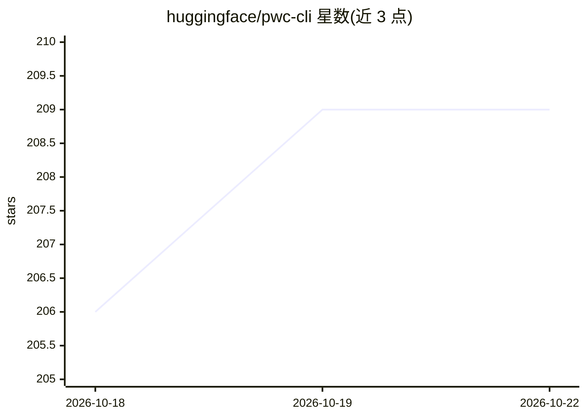

# huggingface/pwc-cli

⭐ 210 · Python · 推送 2026-10-22 · [GitHub](https://github.com/huggingface/pwc-cli) · 组织维护

**面向人类与 coding agent 的 Papers with Code 论文目录 CLI/Skill/MCP 服务**

由 Hugging Face 维护的命令行客户端，读取并编辑 Papers with Code 论文目录：支持论文检索、元数据与 Markdown 阅读、相关/后续/前驱论文追溯，以及任务、方法、会议、组织、框架、基准与排行榜浏览，可用 --json 输出机器可读结果。附带面向 Codex、Cursor 等 coding agent 的 Skill 安装命令，以及匿名只读的 MCP 服务器（Streamable HTTP，每条研究命令对应一个工具）。公开读取无需账号或 API token；论文编辑为需认证的受限工作流（单篇授权、批次与速率限制）。提供预编译二进制与源码安装两种途径。

## 筛选速览

| 维度 | 判定 | 备注 |
|---|---|---|
| AI 角色 | `ai-knowledge` | 知识聚合/清单类 |
| 许可风险 | `none` | — |
| 部署形态 | `None` |  |
| 模型依赖 | — | README 未给出锁定关系 |
| 硬件要求 | — | 无带数字的原话,不猜 |
| 安装摩擦 | `low` | 无编译、无系统依赖或容器化 |
| 成熟度 | — | 结构信号不足 |

## 能力要点

- 论文/任务/方法/基准等目录的检索、浏览与 --json 机器可读输出
- pwc skills add 为 Codex、Cursor 等 coding agent 安装版本匹配的 Skill
- 匿名只读 MCP 服务器，每个 pwc 研究命令对应一个工具
- 受限认证的论文编辑工作流（导出/操作批次/幂等重试）

## 适用场景

- 在终端检索论文、查看基准与 SOTA 结果
- 让 coding agent 通过 Skill 或 MCP 查询论文目录辅助科研编码
- 以 JSON 输出接入脚本与自动化流程

## 场景标签

`科研工具` · 领域:学习与行业

## 证据(README 行号)

> L3: A fast command-line client for exploring and editing the
> L9: The `mcp_server` package exposes an anonymous, read-only,
> L26: - search papers

## 星数曲线

2026-10-18 206 → 2026-10-22 209（+3）

---
*卡片 v1 · prompt 1.4 · 生成 2026-10-22 · 置信度 high · 依据 README sha `5ffd39900bd1` · [字段定义](../../DATASET.md)*
