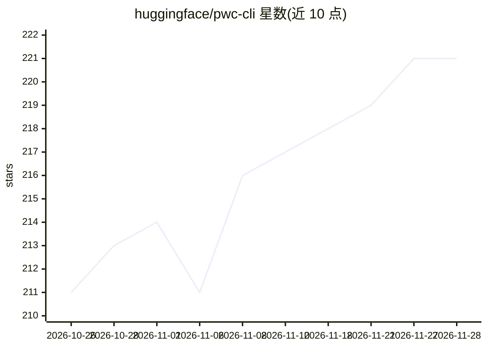

# huggingface/pwc-cli

⭐ 221 · Python · 推送 2026-11-27 · [GitHub](https://github.com/huggingface/pwc-cli) · 组织维护

**为 agent 和人类提供 Papers with Code 目录检索的 CLI、Skill 与 MCP 服务器**

由 Hugging Face 维护的命令行工具，用于检索 Papers with Code 论文目录：搜索论文、按领域查找 SOTA、读取论文元数据与 Markdown、发现近期/趋势/相关工作、追踪论文谱系，以及浏览任务、方法、会议、机构、框架与基准榜单。配套生成编码 agent 的 Skill 与匿名只读的 MCP 服务器（托管端点无需 API key），支持对单篇论文的认证编辑流程（批量操作、幂等重试、每日 20 篇限额）。提供预编译二进制与源码安装（需 Python 3.10+），公开读取匿名。

## 筛选速览

| 维度 | 判定 | 备注 |
|---|---|---|
| AI 角色 | `ai-ecosystem` | LLM/agent 周边工具 |
| 许可风险 | `none` | — |
| 部署形态 | `None` |  |
| 模型依赖 | — | README 未给出锁定关系 |
| 硬件要求 | — | 无带数字的原话,不猜 |
| 安装摩擦 | `low` | 无编译、无系统依赖或容器化 |
| 成熟度 | — | 结构信号不足 |

## 能力要点

- 一个命令覆盖论文/任务/方法/会议/机构/框架/基准目录
- 托管 MCP 服务器匿名只读，支持 Claude Code、Codex、Cursor 等客户端接入
- 自动生成与本地 CLI 版本匹配的 agent Skill（pwc skills add）
- JSON/TSV/Markdown 多种输出格式与稳定退出码，便于脚本化

## 适用场景

- 让编码 agent 查论文、找某个领域的 SOTA 方法
- 脚本化批量检索论文元数据与评测表
- 通过 agent 认证登录后编辑补全单篇论文的评测条目

## 场景标签

`科研工具` · 领域:学习与行业

## 证据(README 行号)

> L3: A fast command-line client for exploring and editing the
> L5: coding agents and a hosted Model Context Protocol server.
> L9: The `mcp_server` package exposes an anonymous, read-only,
> L79: It's recommended to also install the Skill so your coding agent knows how to use the CLI.

## 星数曲线

2026-10-26 211 → 2026-11-28 221（+10）

---
*卡片 v1 · prompt 1.4 · 生成 2026-11-28 · 置信度 high · 依据 README sha `329122dc42ce` · [字段定义](../../DATASET.md)*
