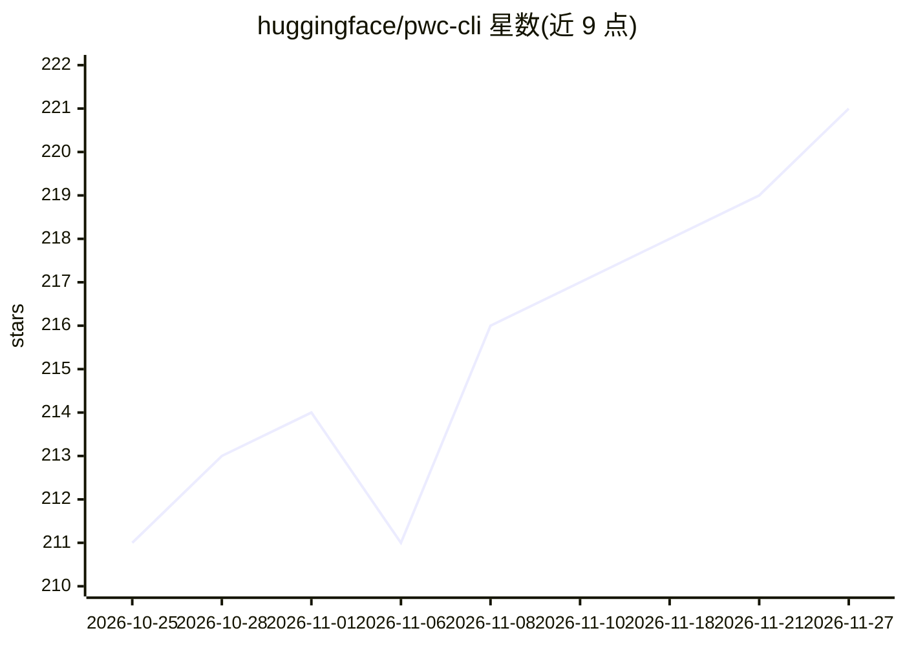

# huggingface/pwc-cli

⭐ 221 · Python · 推送 2026-11-26 · [GitHub](https://github.com/huggingface/pwc-cli) · 组织维护

**面向 agent 与人的 Papers with Code 目录 CLI/Skill/MCP**

命令行客户端，用于检索与编辑 Papers with Code 论文目录：支持论文搜索、元数据读取、趋势与相关工作发现、lineage 追溯，以及任务/方法/会议/组织/框架/基准的浏览与排行榜查询；附带 `pwc skills add` 生成的 Skill（适配 Codex、Cursor、OpenCode 等 agent）与托管/本地可跑的只读 MCP server。公共读取匿名无需凭证，论文编辑需登录授权且限定单篇、一小时写权限、每日与频率限额。提供预编译二进制（SHA-256 校验与构建证明）与源码安装两条路径。

## 筛选速览

| 维度 | 判定 | 备注 |
|---|---|---|
| AI 角色 | `ai-ecosystem` | LLM/agent 周边工具 |
| 许可风险 | `none` | — |
| 部署形态 | `None` |  |
| 模型依赖 | — | README 未给出锁定关系 |
| 硬件要求 | — | 无带数字的原话,不猜 |
| 安装摩擦 | `low` | 无编译、无系统依赖或容器化 |
| 成熟度 | — | 结构信号不足 |

## 能力要点

- CLI + Skill + MCP server 三种形态，一个 research 命令对应一个 MCP 工具
- 公共读取匿名，无账号/API token/Python 环境要求
- 预编译二进制带 SHA-256 校验与 GitHub 构建来源证明
- 论文编辑为显式认证工作流：单篇一小时授权、批量幂等、每日 20 篇限额

## 适用场景

- 让编码 agent 检索论文、查找各领域 SOTA 与官方实现
- 按会议、组织、作者过滤浏览论文目录
- 通过 agent 批量修正某篇论文的评测条目

## 场景标签

`科研工具` · 领域:学习与行业

## 证据(README 行号)

> L3: A fast command-line client for exploring and editing the
> L9: The `mcp_server` package exposes an anonymous, read-only,
> L126: Skills give coding agents the context they need to choose and use `pwc`

## 星数曲线

2026-10-25 211 → 2026-11-27 221（+10）

---
*卡片 v1 · prompt 1.4 · 生成 2026-11-27 · 置信度 high · 依据 README sha `e0c97b50573f` · [字段定义](../../DATASET.md)*
