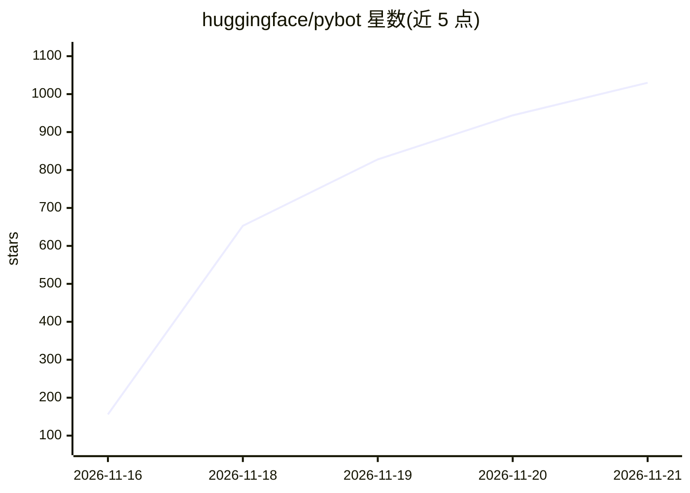

# huggingface/pybot

⭐ 1,030 · Python · Apache-2.0 · 推送 2026-11-16 · [GitHub](https://github.com/huggingface/pybot) · 组织维护

**纯规则聊天机器人：无权重无训练，千余 agent 协作写成**

由超过 1,000 个 agent 协作编写的纯 Python 聊天机器人：不含模型权重，不经过训练，仅由 if-else 分支、正则匹配与查找表构成，约 64 万行代码、55 万行测试。agent 们编写并评估了 5,000 多个版本，在 SmolTalkBench（LLM 裁判对比参考答案）上的胜率从 0% 升至 26%。运行仅需 Python 3.8+，无第三方包、无需下载模型；每轮回复由多个模块提案、仲裁器选定，并拆分出理解引擎、记忆存储、知识库与回复组装四个共享部分。可在终端或浏览器（Hugging Face Space）中对话。

## 筛选速览

| 维度 | 判定 | 备注 |
|---|---|---|
| AI 角色 | `ai-enhanced` | 去掉 AI 部分产品仍成立 |
| 许可风险 | `permissive` | Apache-2.0 |
| 部署形态 | `library` | 以包/库形式分发 |
| 模型依赖 | — | README 未给出锁定关系 |
| 硬件要求 | — | 无带数字的原话,不猜 |
| 安装摩擦 | `low` | 无编译、无系统依赖或容器化 |
| 成熟度 | — | 结构信号不足 |

## 能力要点

- 无权重、无训练：约 64 万行纯 Python 规则代码构成聊天机器人
- 由 1,000+ agent 编写并评估 5,000+ 版本，SmolTalkBench 胜率 0%→26%
- 零依赖运行：仅需 Python 3.8+，无安装包、无模型下载
- 每轮回复由模块提案、仲裁器（arbiter.py）选定，可用 -v 查看来源模块

## 适用场景

- 在终端或浏览器体验纯规则式聊天机器人并查看回复来源模块
- 以单条提问或管道输入方式批量获取回复
- 研究大规模 agent 协作产出的代码结构与规则式对话能力边界

## 场景标签

`聊天机器人` · 领域:对话与助手

## 证据(README 行号)

> L11: We challenged a swarm of over 1,000 agents to build a chatbot entirely in Python: no weights, no training, just if-
> L21: PyBot needs Python 3.8 or newer and nothing else: no packages to install and no model to download.

## 星数曲线

2026-11-16 156 → 2026-11-21 1,030（+874）

---
*卡片 v1 · prompt 1.4 · 生成 2026-11-17 · 置信度 mid · 依据 README sha `bfe8bc11e19f` · [字段定义](../../DATASET.md)*
