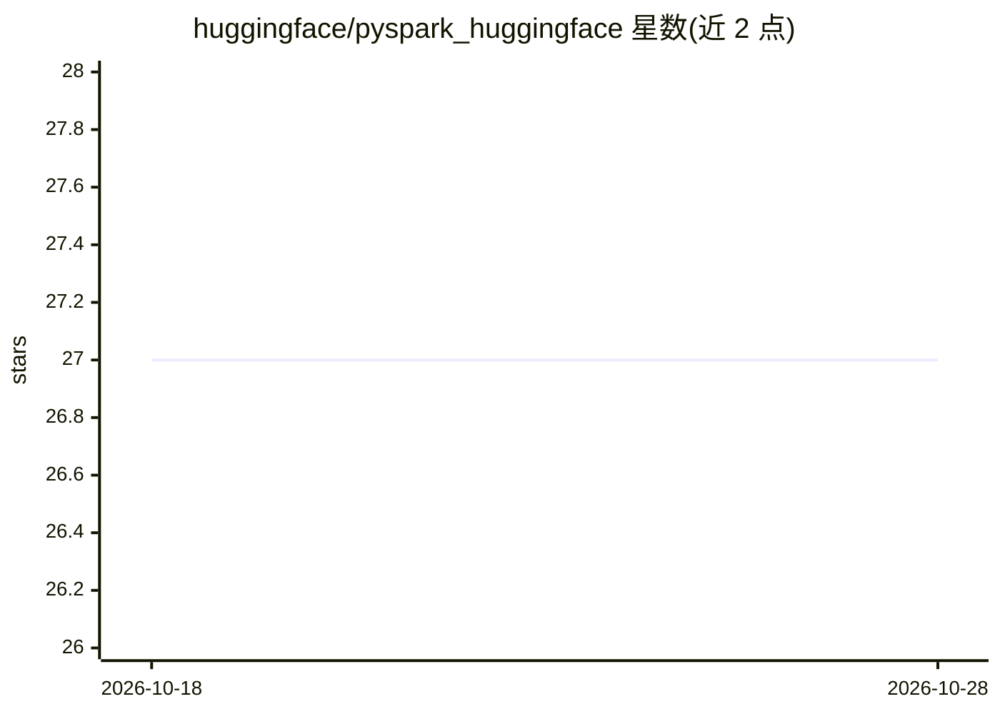

# huggingface/pyspark_huggingface

⭐ 27 · Python · Apache-2.0 · 推送 2026-09-24 · [GitHub](https://github.com/huggingface/pyspark_huggingface) · 组织维护

**Spark 数据源插件：把 Hugging Face 数据集读写为 Spark DataFrame**

为 Apache Spark 提供 Hugging Face Datasets 与 Storage Bucket 的自定义数据源：以流式方式将数据集加载为 Spark DataFrame，支持选择 subset/split、列裁剪与谓词过滤，也可将 DataFrame 以 Parquet 写回 Hugging Face，写入经由 Xet 去重加速。兼容 Spark 4（自动注册），并为 PySpark 3.5/3.4/3.3 提供 import 即启用的 backport。输入格式覆盖 Parquet、Arrow、Lance、JSON、CSV、WebDataset 与媒体文件夹，认证通过 huggingface-cli login 或 token。以 pip 包分发。

## 筛选速览

| 维度 | 判定 | 备注 |
|---|---|---|
| AI 角色 | `ai-ecosystem` | LLM/agent 周边工具 |
| 许可风险 | `permissive` | Apache-2.0 |
| 部署形态 | `library` | 以包/库形式分发 |
| 模型依赖 | — | README 未给出锁定关系 |
| 硬件要求 | — | 无带数字的原话,不猜 |
| 安装摩擦 | `low` | 无编译、无系统依赖或容器化 |
| 成熟度 | — | 结构信号不足 |

## 能力要点

- 流式读取 Hugging Face 数据集为 Spark DataFrame，支持 subset/split 选择
- 投影与谓词下推过滤（对 Parquet 数据集效率更高）
- 写回 Hugging Face 经 Xet 与 Parquet CDC 实现去重快速上传
- Spark 4 自动注册，PySpark 3.5/3.4/3.3 提供 backport

## 适用场景

- 在 Spark 作业中直接读取 Hugging Face 数据集做分布式处理
- 把大规模数据集（如 fineweb-edu）过滤列和行后再分析
- 将处理后的 Spark DataFrame 以 Parquet 保存回 Hugging Face 仓库或 Storage Bucket

## 场景标签

 · 领域:数据工程/大数据

## 证据(README 行号)

> L8: A Spark Data Source for accessing 🤗 Hugging Face Datasets and 🤗 Storage Bucket:
> L10: - Stream datasets from Hugging Face as Spark DataFrames

## 星数曲线

2026-10-18 27 → 2026-10-28 27（+0）

---
*卡片 v1 · prompt 1.4 · 生成 2026-10-26 · 置信度 high · 依据 README sha `4e09a85ffb7f` · [字段定义](../../DATASET.md)*
