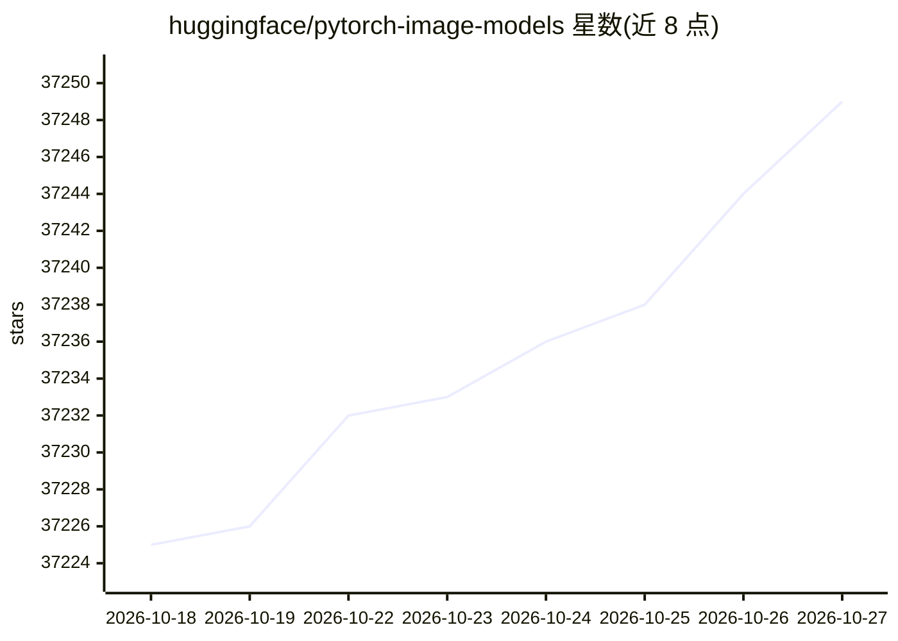

# huggingface/pytorch-image-models

⭐ 37,249 · Python · Apache-2.0 · 推送 2026-10-26 · [GitHub](https://github.com/huggingface/pytorch-image-models) · [官网](https://huggingface.co/docs/timm) · 个人维护

**为 PyTorch 开发者提供图像编码器/骨干网络集合与预训练权重**

timm 是一个 PyTorch 图像模型库，收录多种视觉骨干网络（ResNet、EfficientNet、ViT、Swin Transformer、ConvNeXt 等）的定义与预训练权重，并提供训练、评估、推理、导出脚本（train.py / validate.py / inference.py）以及 ONNX 导出支持。面向计算机视觉研究与工程开发者。近期更新包括 sweep.py 超参网格/随机搜索、多标签分类任务（BCE 训练与 mAP/F1 评估）、WSD 学习率调度器，以及一批新模型权重的接入。

## 筛选速览

| 维度 | 判定 | 备注 |
|---|---|---|
| AI 角色 | `ai-ecosystem` | LLM/agent 周边工具 |
| 许可风险 | `permissive` | Apache-2.0 |
| 部署形态 | `None` |  |
| 模型依赖 | — | README 未给出锁定关系 |
| 硬件要求 | — | 无带数字的原话,不猜 |
| 安装摩擦 | `medium` | 含编译或系统依赖之一 |
| 成熟度 | — | 结构信号不足 |

## 动量与使用信号

- 维护:`active` — 距上次 push 1.5 天,年发版 10,193 位贡献者
- 涨星:近 1 天 **+5**(自 20261016 起算)

## 能力要点

- 提供多种图像分类骨干网络的模型定义与预训练权重
- 附带 train.py、validate.py、inference.py、export 脚本及新的 sweep.py 超参搜索
- 支持多标签分类任务与 mAP/F1 评估指标
- 支持 ONNX 导出与 torch.compile

## 适用场景

- 用预训练权重做图像分类模型的训练与微调
- 为自己的任务挑选并评估不同的视觉骨干网络
- 将训练好的模型导出为 ONNX 用于部署推理

## 场景标签

`微调` · 领域:训练与推理

## 证据(README 行号)

> L1: # PyTorch Image Models
> L8: * Hyperparameter sweeps via a new `sweep.py`: grid / random search over any `train.py` argument, one effective `--co
> L39:  * Add `--task multilabel` to `train.py` / `validate.py`, trained with BCE (`MultiLabelClassificationTask`). See th

## 星数曲线

2026-10-18 37,225 → 2026-10-27 37,249（+24）

---
*卡片 v1 · prompt 1.4 · 生成 2026-10-18 · 置信度 high · 依据 README sha `af877e0bf157` · [字段定义](../../DATASET.md)*
