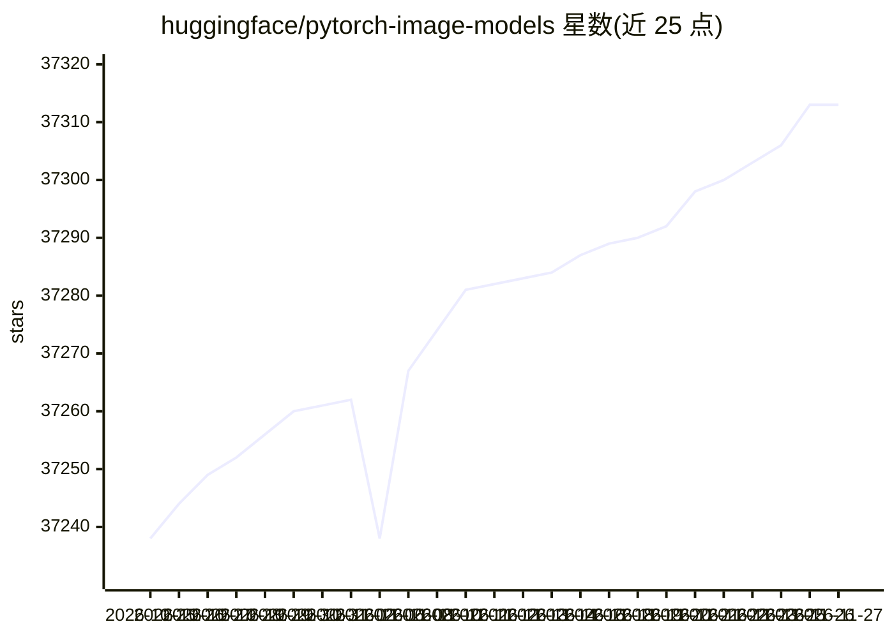

# huggingface/pytorch-image-models

⭐ 37,313 · Python · Apache-2.0 · 推送 2026-11-26 · [GitHub](https://github.com/huggingface/pytorch-image-models) · [官网](https://huggingface.co/docs/timm) · 组织维护

**PyTorch 图像编码器/骨干网络库：训练、评估、推理与预训练权重**

timm 提供大量 PyTorch 图像分类编码器/骨干网络的模型定义与预训练权重（ResNet、EfficientNet、ViT、Swin、ConvNeXt 等），附带 train.py / validate.py / inference.py / export 脚本。机制上覆盖多标签分类、优化器与学习率调度（WSD、plateau 弃用声明）、`forward_intermediates()`、`features_only`、`reset_classifier()`、`set_input_size()`、ONNX 导出与分布式训练。以 pip 库形式发布，面向图像分类/视觉骨干网络使用者。

## 筛选速览

| 维度 | 判定 | 备注 |
|---|---|---|
| AI 角色 | `ai-native` | 本体是模型或模型工具 |
| 许可风险 | `permissive` | Apache-2.0 |
| 部署形态 | `None` |  |
| 模型依赖 | — | README 未给出锁定关系 |
| 硬件要求 | — | 无带数字的原话,不猜 |
| 安装摩擦 | `medium` | 含编译或系统依赖之一 |
| 成熟度 | — | 结构信号不足 |

## 动量与使用信号

- 维护:`active` — 距上次 push 1.5 天,年发版 10,193 位贡献者
- 涨星:近 1 天 **+5**(自 20261016 起算)

## 能力要点

- 收录 ResNet/EfficientNet/ViT/Swin/ConvNeXt 等多族模型定义与预训练权重
- 提供训练、评估、推理、导出脚本，支持多标签分类与分布式训练
- 模型 API 支持 forward_intermediates()、features_only、reset_classifier() 与 set_input_size()
- 新增 sweep.py 超参数网格/随机搜索，支持本地 GPU 池与断点续跑

## 适用场景

- 为下游视觉任务加载预训练图像编码器/骨干网络
- 在 ImageNet 类数据上训练或微调图像分类模型
- 导出 ONNX 格式用于部署
- 在新数据集上做多标签图像分类训练与评估

## 场景标签

`微调` `模型训练` · 领域:训练与推理

## 证据(README 行号)

> L1: # PyTorch Image Models
> L19: * `forward_intermediates()` and `prune_intermediate_layers()` are now supported by every model. Newly added for CSP

## 星数曲线

2026-10-25 37,238 → 2026-11-27 37,313（+75）

---
*卡片 v1 · prompt 1.4 · 生成 2026-11-22 · 置信度 high · 依据 README sha `d3c03d2a03a4` · [字段定义](../../DATASET.md)*
