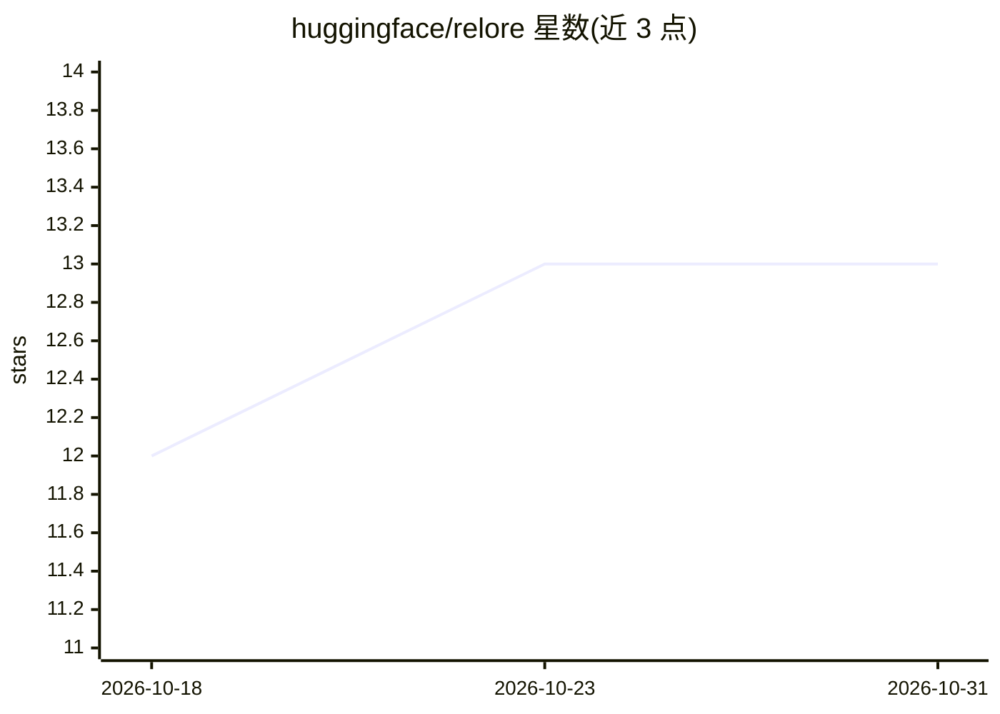

# huggingface/relore

⭐ 13 · Python · Apache-2.0 · 推送 2026-10-28 · [GitHub](https://github.com/huggingface/relore) · 组织维护

**为 AI agent 服务的 GitHub 仓库历史索引与查询服务**

relore 索引仓库完整的 issue 与 PR 历史，并在服务端维护工作克隆，通过一个 HTTP API 提供三类查询：inflight 查开放认领者避免重复工作；thread/why/search 返回带作者与信任层级（maintainer/contributor/bot）的评论级历史决策；grep/symbol/copies 针对服务端克隆运行以核验陈述。查询全部走 Postgres，不发 GitHub 请求。运行需 Postgres 与只读 GitHub token，deploy/ 提供 Helm chart；局限是索引新鲜度。面向接入 agent harness 的开发者。

## 筛选速览

| 维度 | 判定 | 备注 |
|---|---|---|
| AI 角色 | `ai-ecosystem` | LLM/agent 周边工具 |
| 许可风险 | `permissive` | Apache-2.0 |
| 部署形态 | `library` | 以包/库形式分发 |
| 模型依赖 | — | README 未给出锁定关系 |
| 硬件要求 | — | 无带数字的原话,不猜 |
| 安装摩擦 | `low` | 无编译、无系统依赖或容器化 |
| 成熟度 | — | 结构信号不足 |

## 能力要点

- 索引 issue/PR 全历史并在服务端保留工作克隆
- 信任层级过滤（仅保留有写权限者确认的内容，默认排除机器作者）
- 所有查询为 Postgres 查询，无 GitHub API 请求
- 词法索引与排序，无 embedding

## 适用场景

- agent 开工前检查是否已有人在处理同一问题
- 查询某段代码为何如此设计的历史决策
- 用服务端 grep/symbol 核验历史评论是否仍成立

## 场景标签

`网页抓取` · 领域:效率与自动化

## 证据(README 行号)

> L7: `relore` indexes a repository's complete issue and pull-request history and keeps a working
> L27: Relore connects project history with current code to answer an agent's three questions.
> L70: - `docs/agents.md` — wiring it into a harness (not to be confused with

## 星数曲线

2026-10-18 12 → 2026-10-31 13（+1）

---
*卡片 v1 · prompt 1.4 · 生成 2026-10-31 · 置信度 mid · 依据 README sha `6ecd433c9e60` · [字段定义](../../DATASET.md)*
