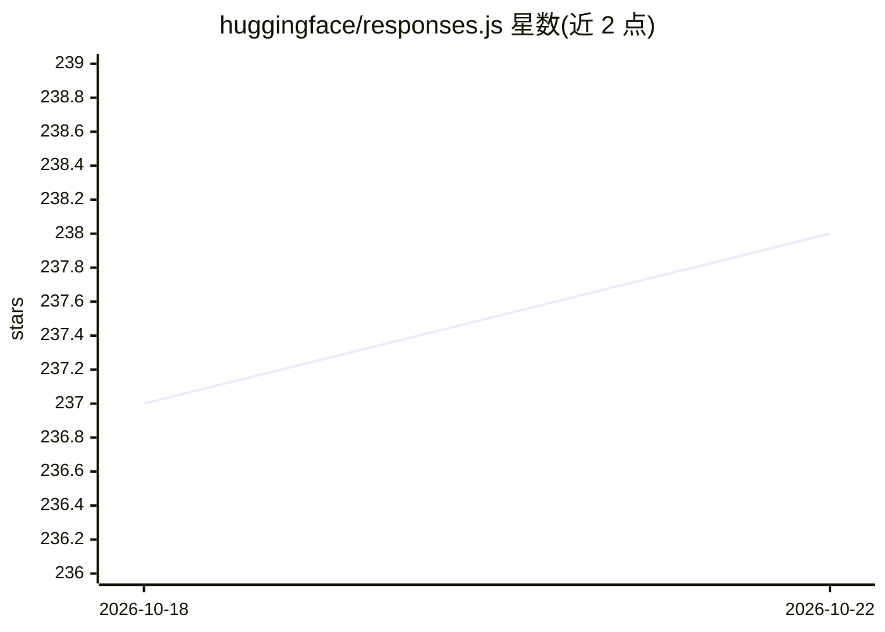

# huggingface/responses.js

⭐ 239 · TypeScript · MIT · 推送 2026-10-14 · [GitHub](https://github.com/huggingface/responses.js) · 组织维护

**Express.js 服务器：把 OpenAI Responses API 翻译到 Chat Completions API**

轻量 Express.js 服务器，在 OpenAI Responses API 与 Chat Completions API 之间实现翻译层，可对接任意本地或远程的 Chat Completion API，默认场景为 Hugging Face Inference Providers 并需 HF token。已实现流式响应、结构化输出、函数调用、多模态输入（文本/图像）与远程 MCP 工具调用；未实现远程函数调用、文件上传与有状态 API。提供 Web Demo UI、示例脚本与 Docker 镜像，需 Node.js 18+ 与 pnpm 从源码运行。

## 筛选速览

| 维度 | 判定 | 备注 |
|---|---|---|
| AI 角色 | `ai-ecosystem` | LLM/agent 周边工具 |
| 许可风险 | `permissive` | MIT |
| 部署形态 | `self-host` | docker 或自建部署 |
| 模型依赖 | — | README 未给出锁定关系 |
| 硬件要求 | — | 无带数字的原话,不猜 |
| 安装摩擦 | `low` | 无编译、无系统依赖或容器化 |
| 成熟度 | `idea` | |

## 能力要点

- 在 Chat Completions 之上实现 Responses API 的部分翻译层，Provider 无关
- 支持流式、结构化输出、函数调用、多模态输入与远程 MCP
- 附带交互式 Web Demo UI 与示例脚本
- 提供 Docker 生产容器运行方式

## 适用场景

- 让仅支持 Responses API 的客户端接入任意 Chat Completions 后端
- 在本地或自托管环境中模拟 OpenAI Responses API
- 通过 Demo UI 交互测试 API 能力

## 场景标签

 · 领域:LLM 基础设施/API 网关

## 证据(README 行号)

> L3: A lightweight Express.js server that implements a translation layer between the two main LLM APIs currently availabl
> L11: - **ResponsesAPI**: Partial implementation of OpenAI's Responses API, on top of Chat Completion API

## 星数曲线

2026-10-18 237 → 2026-10-22 238（+1）

---
*卡片 v1 · prompt 1.4 · 生成 2026-10-22 · 置信度 high · 依据 README sha `821b7855243d` · [字段定义](../../DATASET.md)*
