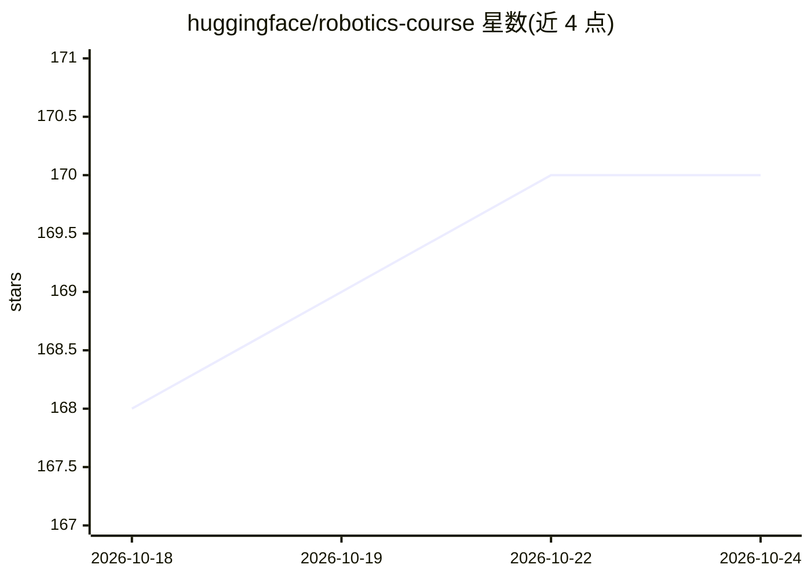

# huggingface/robotics-course

⭐ 170 · MDX · 推送 2026-10-14 · [GitHub](https://github.com/huggingface/robotics-course) · 组织维护

**Hugging Face 机器人学课程：从经典方法到学习方法的实践教程**

由 Hugging Face 团队维护的免费机器人学课程，内容覆盖经典机器人学基础到基于学习的现代方法，包括强化学习、模仿学习与机器人基础模型。课程依托 Robot Learning Tutorial 改写为社区更易获取的形式，实践部分围绕 LeRobot 框架展开，学员将使用真实机器人数据集并实现算法。部分单元已发布，强化学习、模仿学习、基础模型单元标注 Coming Soon。课程在 Hugging Face Hub 上提供。

## 筛选速览

| 维度 | 判定 | 备注 |
|---|---|---|
| AI 角色 | `ai-knowledge` | 知识聚合/清单类 |
| 许可风险 | `none` | — |
| 部署形态 | `None` |  |
| 模型依赖 | — | README 未给出锁定关系 |
| 硬件要求 | — | 无带数字的原话,不猜 |
| 安装摩擦 | `low` | 无编译、无系统依赖或容器化 |
| 成熟度 | — | 结构信号不足 |

## 能力要点

- 课程结构从经典机器人学过渡到学习方法
- 实践基于 LeRobot 框架与真实机器人数据集
- 由 Robot Learning Tutorial 精简改写为社区课程

## 适用场景

- 系统学习从经典机器人学到学习方法的完整路径
- 入门 LeRobot 框架并将其用于真实机器人系统
- 了解机器人强化学习与模仿学习的基础知识

## 场景标签

`教程课程` · 领域:学习与行业

## 证据(README 行号)

> L7: This free course will take you on a journey, **from classical robotics to modern learning-based approaches**, in und
> L18: Across the course you will study classical robotics foundations and modern learning‑based approaches, learn to use 

## 星数曲线

2026-10-18 168 → 2026-10-24 170（+2）

---
*卡片 v1 · prompt 1.4 · 生成 2026-10-22 · 置信度 high · 依据 README sha `21adc84e649a` · [字段定义](../../DATASET.md)*
