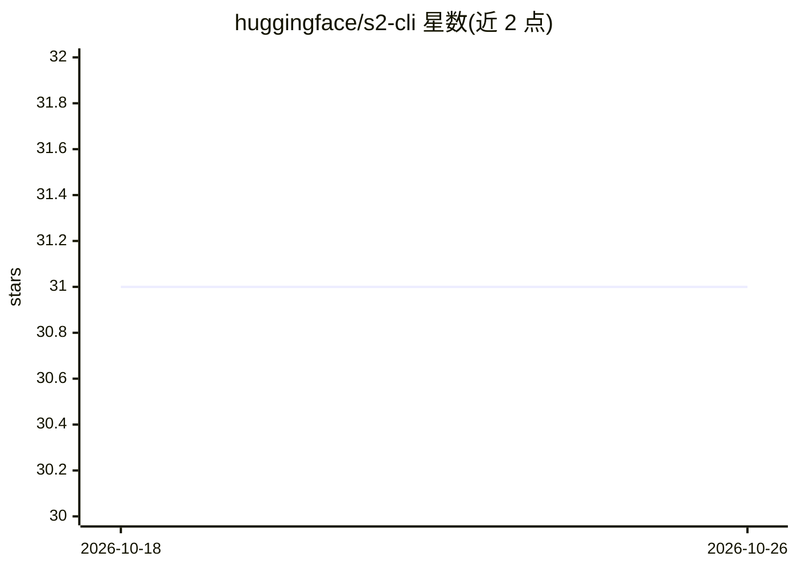

# huggingface/s2-cli

⭐ 31 · Python · Apache-2.0 · 推送 2026-09-24 · [GitHub](https://github.com/huggingface/s2-cli) · 组织维护

**查询 Semantic Scholar 的只读命令行客户端，供人类与编码 agent 使用**

面向 Semantic Scholar Graph API 的只读 CLI，提供三个命令：s2 refs 查某文献的参考文献、s2 citations 查引用某文献的论文、s2 search 在图谱上做相关性检索。可通过标题、arXiv ID、DOI、URL 等多种格式指定论文，标题匹配结果输出到 stderr 以便校验。输出为无损 TSV 或 JSON，带稳定退出码与限速配置。附带 SKILL.md 可安装到 agent 技能目录。需 Semantic Scholar API key，Python 3.10+。

## 筛选速览

| 维度 | 判定 | 备注 |
|---|---|---|
| AI 角色 | `ai-ecosystem` | LLM/agent 周边工具 |
| 许可风险 | `permissive` | Apache-2.0 |
| 部署形态 | `None` |  |
| 模型依赖 | — | README 未给出锁定关系 |
| 硬件要求 | — | 无带数字的原话,不猜 |
| 安装摩擦 | `low` | 无编译、无系统依赖或容器化 |
| 成熟度 | — | 结构信号不足 |

## 能力要点

- refs/citations/search 三个命令覆盖引文关系与图谱检索
- 支持标题、arXiv ID、DOI、URL 等多种论文标识格式
- 无损 TSV 输出与稳定退出码，便于脚本化与 agent 调用
- 附 SKILL.md 可安装为编码 agent 的技能

## 适用场景

- 在终端或脚本中查某篇论文的引用与被引列表
- 为编码 agent 添加文献检索技能
- 在本地文献目录之外检索 Semantic Scholar 图谱

## 场景标签

`科研工具` · 领域:学习与行业

## 证据(README 行号)

> L3: A fast, read-only command-line client for the Semantic Scholar Graph API, alongside a Skill for coding agents.
> L53: Copy `SKILL.md` into your agent's skills directory:

## 星数曲线

2026-10-18 31 → 2026-10-26 31（+0）

---
*卡片 v1 · prompt 1.4 · 生成 2026-10-26 · 置信度 high · 依据 README sha `6d7cc36a2c3a` · [字段定义](../../DATASET.md)*
