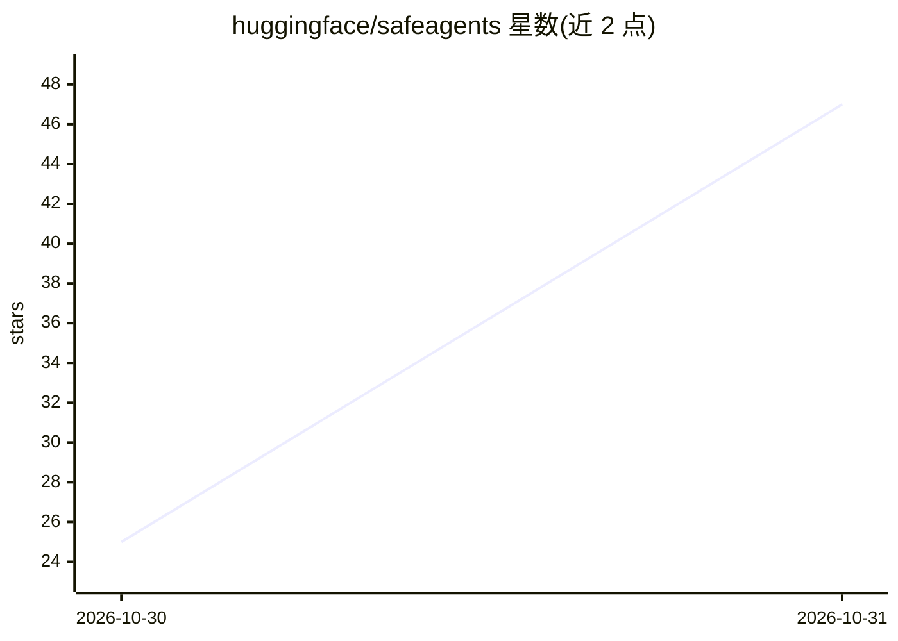

# huggingface/safeagents

⭐ 47 · Python · Apache-2.0 · 推送 2026-10-30 · [GitHub](https://github.com/huggingface/safeagents) · 组织维护

**本地代理：在编码 agent 执行前检查并拦截危险工具调用**

部署在 agent 与模型服务器之间的轻量本地代理，兼容 OpenAI Chat Completions 与 Anthropic Messages（含流式），任何可设置 base URL 的 harness（Claude Code、Pi、Hermes、OpenCode 等）均可接入。每次工具调用经三阶段检查：请求级校验（未声明工具、陌生主机）、atif-scan 检测器（如读取 /proc/1/environ、K8s token 等）、可选判定模型裁决，被拦截的调用被替换为文本提示使 harness 不执行。支持 --log-only 只报告不拦截、日志与 inspect 查看明细，docs/ 含 12 个编码 agent 的接入指南。

## 筛选速览

| 维度 | 判定 | 备注 |
|---|---|---|
| AI 角色 | `ai-ecosystem` | LLM/agent 周边工具 |
| 许可风险 | `permissive` | Apache-2.0 |
| 部署形态 | `library` | 以包/库形式分发 |
| 模型依赖 | locked-api |  |
| 硬件要求 | — | 无带数字的原话,不猜 |
| 安装摩擦 | `low` | 无编译、无系统依赖或容器化 |
| 成熟度 | — | 结构信号不足 |

## 能力要点

- 三阶段工具调用检查：请求校验、atif-scan 检测器、可选判定模型
- 与任意可设 base URL 的 harness 兼容（OpenAI/Anthropic 协议，流式无额外延迟）
- --log-only 模式与 calls.jsonl 记录、inspect 命令查看被拦截调用
- 内置 allowlist 覆盖 loopback、GitHub、PyPI、Hugging Face、npm、crates.io

## 适用场景

- 让编码 agent 在沙箱外执行命令前拦截危险工具调用
- 以只记录模式审计 agent 实际发起的调用
- 统一给团队内多种 coding agent 加一道本地安全代理

## 场景标签

`网络安全` · 领域:学习与行业

## 证据(README 行号)

> L3: A lightweight local proxy between your agent and its model server. It checks every tool call the model makes before 
> L70: 1. **Request-only checks.** A call is blocked if it uses a tool the request never declared, or if its arguments con

## 星数曲线

2026-10-30 25 → 2026-10-31 47（+22）

---
*卡片 v1 · prompt 1.4 · 生成 2026-10-30 · 置信度 mid · 依据 README sha `42b0b99efa57` · [字段定义](../../DATASET.md)*
